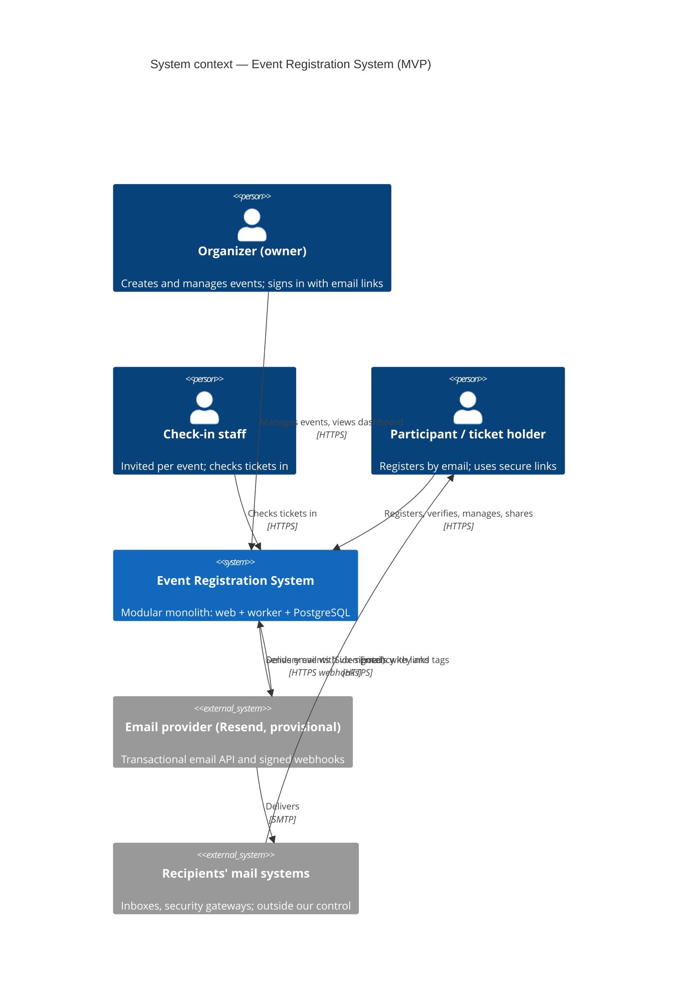
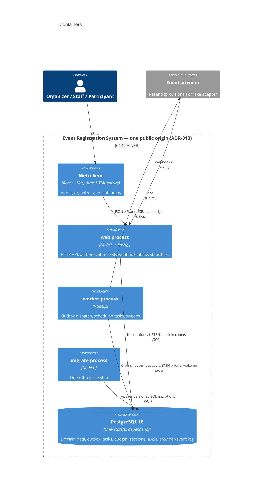
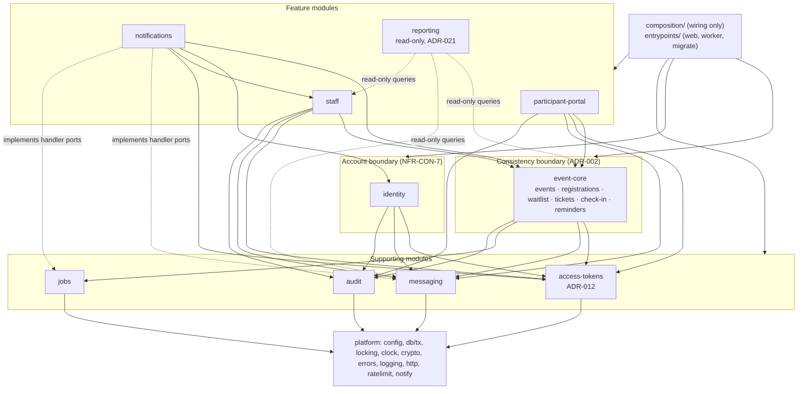
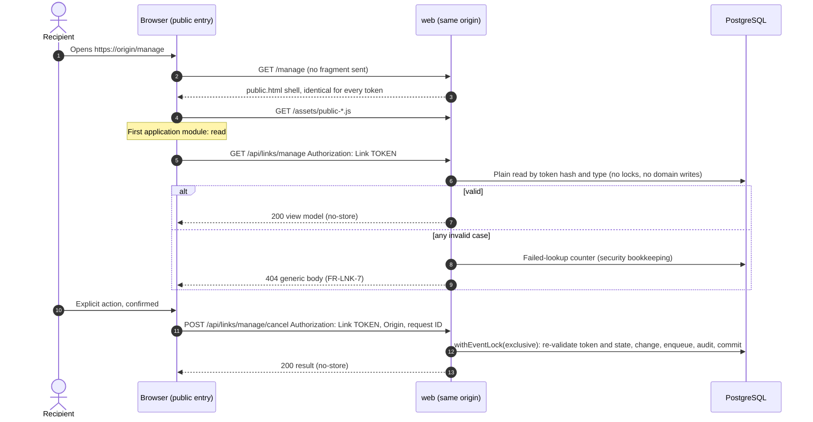
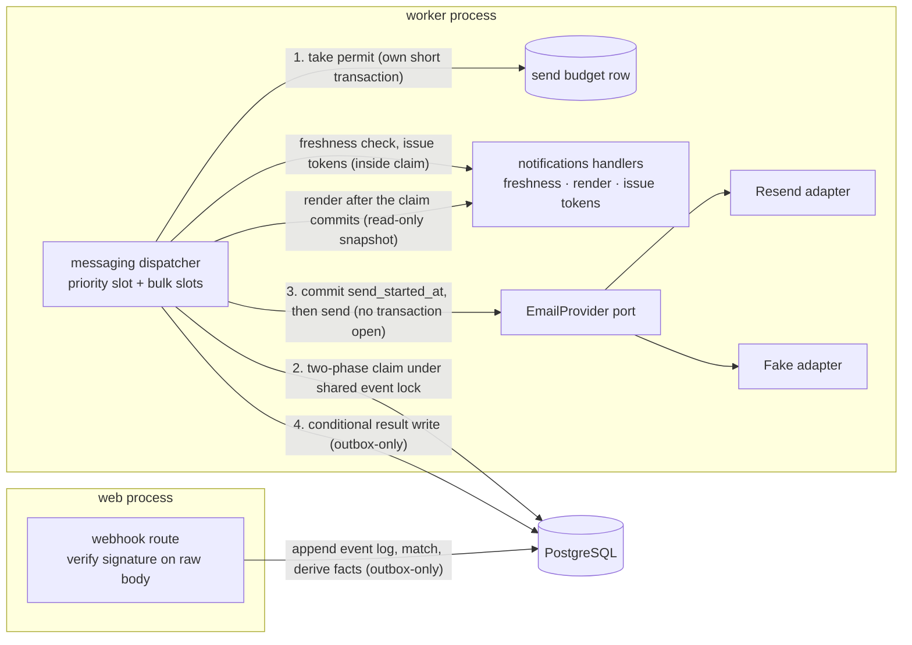
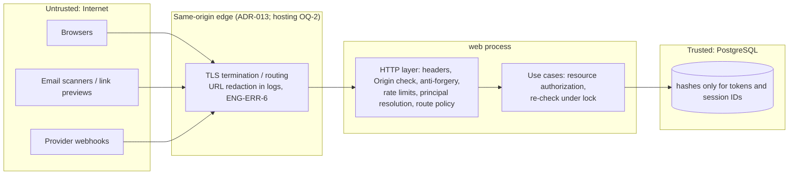
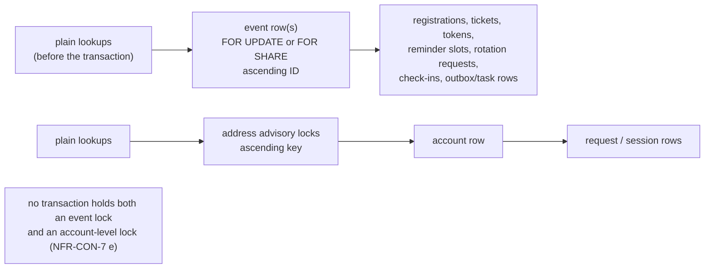

# Event Registration System — Architecture

| | |
|---|---|
| **Status** | Phase 1 Architecture Blueprint — approved 2026-10-11 |
| **Requirements baseline** | [REQUIREMENTS.md](../../REQUIREMENTS.md) v1.6 (authoritative; this document doesn't restate it) |
| **Decision index** | [docs/adr/README.md](../adr/README.md) |
| **Module rules** | [MODULES.md](MODULES.md) |
| **Database design** | [docs/database/](../database/DATABASE_DESIGN.md) (approved baseline, 2026-10-11) |

## How to read this document

Every architectural statement carries one of these labels:

| Label | Meaning |
|---|---|
| **[Req: ID]** | Fixed by REQUIREMENTS.md v1.5. This document only shows where it lives in the architecture. |
| **[ADR-nnn]** | An approved architecture decision record in `docs/adr/`. |
| **[Blueprint]** | Approved as part of the Phase 1 Architecture Blueprint (2026-10-11). Not yet recorded in its own ADR. |
| **[Proposed: ADR-nnn]** | A recommendation whose ADR has not been written or approved. It can still change. |
| **[Open: OQ-n]** | Blocked by an open question in REQUIREMENTS.md §12. Not decided here. |

Where this document and REQUIREMENTS.md disagree, REQUIREMENTS.md wins, and the disagreement is a defect in this document.

---

## 1. Goals and constraints

- **One deployable TypeScript codebase**, started as three independent processes: `web`, `worker` and `migrate` **[Req: R51]**.
- **PostgreSQL is the only stateful dependency.** It holds all domain state and is also the coordination mechanism: row locks, the transactional outbox, scheduled tasks, rate-limit counters, the send budget and `LISTEN/NOTIFY` **[Req: R51, NFR-REL-14 h]**.
- **No Redis, message broker, microservices or Kubernetes** in the MVP **[Req: R51 (8)]**.
- **Built and run by a single developer.** Prefer explicit, boring mechanisms over frameworks and speculative abstractions **[Req: ENG-CQ-1, ENG-CQ-5]**.
- **Correctness under concurrency comes first.** It is the system's main technical risk **[Req: NFR-CON-1 to NFR-CON-7, NFR-REL-1 to NFR-REL-18]**.

## 2. System context

- **The provider is provisional.** Resend is gated for production on §12.1a, OQ-18 and OQ-19 **[Req: R56, OQ-3]**. Everything provider-specific stays behind the provider adapter (§7).
- **Mail systems are outside our control.** Fragment loss and URL logging by email gateways are accepted limitations **[Req: EC-98, AC-179]**.

## 3. Containers and processes

| Container | Responsibility | Label |
|---|---|---|
| **Web client** | Three HTML entries: `public` (event page, registration, every link page), `organizer` and `staff`. Each entry has its own headers and content security policy, and organizer code never loads on link pages. | [Blueprint]; headers [Req: FR-LNK-8] |
| **`web` process** | HTTP API, session authentication, authorization, anti-forgery checks, rate limiting, link resolution, live check-in counts over SSE, provider webhook intake, serving the built client, health endpoint. | [Req: R51]; webhook and static placement [Blueprint] |
| **`worker` process** | Outbox dispatch with a reserved priority slot and bulk slots, scheduled tasks (reminder fan-out, cutoff processing), housekeeping sweeps (lease reaper, retry-horizon expiry, evidence-window timer), alert-only reconciliation, heartbeat. | [Req: R51, NFR-REL-9, NFR-REL-12, NFR-REL-14, NFR-CON-5] |
| **`migrate` process** | Applies versioned SQL migrations as an explicit release step. No other process ever migrates. | [Req: R51, ENG-CI-6] |
| **PostgreSQL 18** | All state, plus every coordination mechanism (§6). | [Req: R51]; version: §6.1 |
| **Email provider** | Reached only through the provider port. A fake adapter is used in development, tests and the AC-169 load test. | [Req: R56, ENG-TST-9, AC-169] |

### 3.1 Process rules

- **The processes start independently.** Each validates its configuration and fails fast, naming a missing variable without showing its value **[Req: ENG-DOC-2, AC-143]**.
- **`web` and `worker` check the schema version at startup** and refuse to start on a mismatch **[Req: ENG-CI-6, AC-141]**. The worker also refuses to start if the retry horizon is at or above the provider's idempotency-key retention **[Req: AC-162]**.
- **Processes communicate only through PostgreSQL:** outbox and task rows, plus `NOTIFY`. There are no direct calls between processes **[Blueprint]**.
- **Error boundaries and crash policy follow ENG-ERR-5.** Recovery relies on transaction rollback, leases and webhook redelivery **[Req: ENG-ERR-5, AC-138]**.

| Process | Database connections | Label |
|---|---|---|
| `web` | One pool, plus one dedicated `LISTEN` connection for check-in counts | [Blueprint] |
| `worker` | One `LISTEN` connection for priority wake-ups, plus a bounded pool sized for its slots: at least one reserved priority slot and N bulk slots | [Req: NFR-REL-12, NFR-REL-14 g]; sizing [Blueprint] |
| `migrate` | One connection, holding a migration lock for the whole run | [Proposed: ADR-018] |

## 4. Modular monolith structure

The backend is one codebase made of modules with explicit public interfaces. Ownership, interfaces and dependency rules are specified in [MODULES.md](MODULES.md).

The `platform` arrows from the upper layers are omitted for readability: every module may use `platform`.

**Key points:**
- **`event-core` is the single consistency boundary** for everything serialized by the event-row lock. Its code is split into internal domains, and other modules call only its public interface **[ADR-002]**.
- **`access-tokens` owns every link token** in one table, and is the single place that produces the generic invalid-link response **[ADR-012; Req: FR-LNK-7]**.
- **`reporting` reads across module tables but never writes** them, and no write path depends on it **[ADR-021]**.
- **`messaging` is a domain-agnostic delivery engine.** `notifications` supplies the per-message-type freshness checks, rendering and link issuance through a handler port **[Blueprint]**.

## 5. Frontend structure and routing

### 5.1 One public origin

The three HTML entries, their static assets, the JSON API, SSE and the provider webhook endpoint are all served from **one public origin** (scheme, host and port) **[ADR-013]**.

- **Why it's required:**
  - `__Host-` session cookies with `SameSite=Lax` **[Req: FR-ORG-4]**.
  - The no-CORS link-token transport **[Req: FR-LNK-10 c]**.
  - Content security policies limited to `'self'` **[Req: FR-LNK-8]**.
- **What it does not require:** serving everything from one process. A reverse proxy or CDN may route paths to separate deployments. How the routing is hosted stays open **[Open: OQ-2]**.

| Path family (illustrative; final paths are an API-design decision) | Served by | Area |
|---|---|---|
| `/e/<public id>` | `public.html` | Public event page and registration [Req: FR-EVT-12] |
| `/verify`, `/manage`, `/ticket`, `/invite`, `/sign-in`, `/email-change` (token in `#t=`) | `public.html` (identical bytes for every token) | Link pages [Req: FR-LNK-10, AC-174] |
| `/organizer/*` | `organizer.html` | Organizer area (organizer session cookie) |
| `/staff/*` | `staff.html` | Staff check-in area (staff session cookie) |
| `/api/links/<type>` and its `POST` actions | `web` | Link resolution and actions; ignores session cookies [Req: FR-LNK-10 c, AC-178] |
| `/api/*` (other) | `web` | Organizer and staff API |
| `/api/events/<id>/live` | `web` | SSE check-in count [Req: FR-DSH-2, FR-DSH-3] |
| `/webhooks/email` | `web` | Provider webhooks; signature verified on the raw body [Req: NFR-REL-15 a] |

### 5.2 Link-token transport

Link tokens travel in the URL fragment, are kept only in page memory, and reach the API only in the `Authorization: Link` header. Opening a link resolves it with a read-only request; every state change is an explicit `POST` **[ADR-011; Req: FR-LNK-10]**.

**Frontend rules:**
- **No token storage** in cookies, `localStorage`, `sessionStorage`, IndexedDB or the URL **[Req: FR-LNK-10 b, AC-175]**.
- **No third-party resources** on link pages **[Req: FR-LNK-8]**.
- **The staff area never caches ticket codes**, and shows "cannot validate" while offline **[Req: FR-CHK-6, FR-CHK-7]**.
- **The SSE client re-fetches the authoritative count** on every (re)connect **[Req: FR-DSH-3]**.
- **Areas don't import each other.** They share only `shared/` and the contracts package **[Blueprint]**.

## 6. PostgreSQL integration

### 6.1 Version

- **PostgreSQL 18** is the target major version for **development, testing (Testcontainers images) and database design** (stakeholder directive, 2026-10-11).
- **Production on PostgreSQL 18 is conditional** on the chosen hosting supporting it. **OQ-2 stays partially open:** hosting provider, region and data residency, and confirmation of the production version.
- **Recorded in REQUIREMENTS.md v1.6 as R59:** OQ-2 is partially resolved (PostgreSQL 18 for development, testing and design).

### 6.2 What PostgreSQL is used for

| Mechanism | Where it is specified | Owning module |
|---|---|---|
| Event-row lock (`FOR UPDATE` / `FOR SHARE`) as the serialization point | [Req: NFR-CON-1, NFR-CON-4] | `platform` (lock helpers), `event-core` (rules) |
| Confirmed-count triggers and `CHECK` constraints | [Req: NFR-CON-5] | `event-core` |
| Address advisory locks, then the account row, then request and session rows | [Req: NFR-CON-7] | `platform` (lock helpers), `identity` |
| Transactional outbox, two-phase claim, leases, attempt numbers | [Req: NFR-REL-1, NFR-REL-9, NFR-CON-4 e, NFR-CON-6] | `messaging` |
| Scheduled tasks (reminder fan-out, cutoff) with the same claim protocol | [Req: NFR-CON-4 e, NFR-REL-5] | `jobs` (engine), `notifications` (handlers) |
| Two-bucket send budget and sending pause | [Req: NFR-REL-14] | `messaging` |
| Immutable provider-event log | [Req: NFR-REL-15, NFR-REL-18] | `messaging` |
| Rate-limit counters | [Req: NFR-SEC-3, FR-LNK-7]; mechanism [Proposed: ADR-015] | `platform` |
| `LISTEN/NOTIFY`: check-in counts (to `web`), priority wake-up (to `worker`) | [Req: R51 (5), NFR-REL-12 b] | `platform` (helper), `event-core`, `messaging` |

The physical schema is the subject of the next phase (database design). It is not fixed by this document.

## 7. Email provider integration

- **Port and adapters.** `messaging` defines an `EmailProvider` port. The Resend and fake adapters map raw responses to the NFR-REL-13 categories, so the state machine stays provider-independent. A future SES adapter fits the same port **[Req: OQ-3 fallbacks, ENG-CQ-1]**; the interface details are **[Proposed: ADR-008]**.
- **Requirements this integration implements, without restating them here:**
  - The send state machine, sticky `possibly_accepted` and settling rules **[Req: NFR-REL-13]**.
  - Key generations and regeneration classes **[Req: NFR-REL-16]**.
  - The send budget and reserved concurrency **[Req: NFR-REL-14]**.
  - Webhook ingestion and derived delivery facts **[Req: NFR-REL-15, NFR-REL-18]**.
  - Deterministic rendering **[Req: NFR-REL-17]**.
  - No click or open tracking **[Req: NFR-SEC-9]**.
- **Tokens are never in the outbox.** Link tokens are issued at send time, inside the claim transaction **[Req: FR-LNK-3, BR-19]**. Their raw values stay in worker memory only until the provider call returns.
- **Rendering happens after the claim commits**, from one read-only snapshot, with a recheck that can only cancel a send. `send_started_at` is committed **before** any provider request, so a crash can always be classified as "definitely not submitted" or "possibly accepted" **[Approved: D-2; Req: NFR-REL-13 c, h]**. Details: [TRANSACTIONS_AND_LOCKING.md §6](../database/TRANSACTIONS_AND_LOCKING.md#6-send-pipeline-and-crash-safety-d-2).
- **No provider call happens inside a database transaction** **[Req: NFR-CON-4 g]**.

## 8. Security and authorization boundaries

### 8.1 Trust boundaries

### 8.2 Principals and authorization layers

| Principal | Established by | May do | Label |
|---|---|---|---|
| `OrganizerPrincipal` | `__Host-` organizer session cookie; the session ID is hashed and looked up on every request | Owner actions on **own** events only; cross-owner access returns `404` | [Req: FR-ORG-4, NFR-SEC-6, AC-155] |
| `StaffPrincipal` | `__Host-` staff session cookie under a separate name, scoped to one event | Check-in and checked-in count for that event only | [Req: FR-STAFF-2, AC-26, AC-151] |
| `LinkCapability(type, subject)` | `Authorization: Link` header on `/api/links/<type>` only; session cookies ignored | Exactly what that link type allows | [Req: FR-LNK-10 c, FR-SHR-3] |
| `Anonymous` | — | Public event page, registration, sign-in request | [Req: §3] |
| `System` | `worker` process | Claims, sends, sweeps | [Blueprint] |

Authorization happens in **two layers** **[Blueprint]**:
1. **A route policy** declares which principal kind a route accepts. Recent-authentication routes additionally require a sign-in within the last 15 minutes **[Req: FR-ORG-5]**.
2. **The use case checks the resource:** event ownership, staff event scope, or that a link still grants the action. Event-scoped use cases repeat this check **after** taking the event lock, through an `authorize(tx)` callback supplied by the caller. This gives the strict revocation-versus-check-in ordering **[Req: FR-ORG-4, FR-STAFF-2, AC-156]**. It also keeps `event-core` independent of `identity` and `staff` (MODULES.md §4).

### 8.3 Security controls by boundary

| Control | Boundary | Label |
|---|---|---|
| CSP limited to `'self'`, `frame-ancestors 'none'`, `no-referrer`, `no-store`, `noindex` on every link page and link API response | HTTP layer | [Req: FR-LNK-8, AC-51] |
| No CORS headers anywhere | HTTP layer | [Req: FR-LNK-10 c, AC-177] |
| Anti-forgery token tied to the session, plus an `Origin` check, on every state-changing request; a pre-session token for sign-in confirmation | HTTP layer | [Req: NFR-SEC-8, FR-ORG-3 d, FR-ORG-4]; mechanism [Proposed: ADR-010] |
| A single generic invalid-link responder with a per-IP failure limit | `access-tokens` | [Req: FR-LNK-7, BR-30] |
| Hash-only storage of every token and session ID; raw values only at issuance | `access-tokens`, `identity`, `staff` | [Req: FR-LNK-1, NFR-SEC-1, AC-61]; hash function undecided [ADR-012] |
| Webhook signature verified on the raw body; acknowledged only after commit | `messaging` | [Req: NFR-REL-15 a, f] |
| Log allow-list and redaction; credential headers and bodies never logged; token segments in URLs redacted | `platform`, edge | [Req: ENG-ERR-6, AC-139] |
| Error responses carry no stack traces, SQL, constraint names, tokens or hashes | `platform` | [Req: ENG-ERR-3, AC-137] |
| Staff never see participant data; scan results show outcomes only | `event-core`, staff area | [Req: §3, FR-CHK-4] |
| Audit records hold opaque IDs only and survive event deletion | `audit` | [Req: NFR-SEC-5, FR-EVT-14] |

## 9. Transaction and concurrency boundaries

The protocols are fixed by NFR-CON-4, NFR-CON-6 and NFR-CON-7. The architecture's job is to make deviating from them hard.

| Transaction kind | First lock | Used by | Label |
|---|---|---|---|
| **Event, exclusive** | `SELECT … FROM events … FOR UPDATE` | Every event-scoped state change listed in NFR-CON-1 and AC-133 | [Req: NFR-CON-1, NFR-CON-4 a] |
| **Event, shared** | `FOR SHARE` on the event row(s), ascending ID | Outbox and scheduled-task claims; insert-only tasks such as reminder fan-out | [Req: NFR-CON-4 a, e] |
| **Account** | Address advisory locks (ascending key), then the account row, then request and session rows | Sign-in, account creation, email change, sign-out everywhere, session revocation | [Req: NFR-CON-7] |
| **Outbox-only** | One outbox or task row, or `SKIP LOCKED` in ID order | Result writes, reaper, retry-horizon expiry, evidence timer, webhook processing | [Req: NFR-CON-6] |
| **Isolated single row** | That row, in its own short transaction | Send permit, sending pause, rate-limit counter, session "last seen" | [Req: NFR-REL-14 c, NFR-CON-6, NFR-CON-7 g] |
| **Read-only** | None (`READ ONLY` transaction) | `reporting` queries, link resolution reads, pre-transaction lookups | [ADR-021]; [Req: NFR-CON-4 b] |

**How the platform enforces the protocol:**
- **Typed transactions:** `withEventLock` and `withAccountLocks` are the only ways to obtain an event-locked or account-locked transaction. Event-scoped data-access functions accept only an event-locked transaction **[Req: ENG-CQ-2, AC-144]**; the type-level design is **[Proposed: ADR-003]**.
- **Bounded retries** for deadlock, serialization and lock-timeout failures **[Req: NFR-CON-4 h, ENG-ERR-7]**.
- **A test-mode lock recorder** for AC-157 (b) **[Req: AC-157]**; its design is **[Proposed: ADR-003]**.
- **Fixed statement order inside a transaction:** decrements and capacity increases before increments **[Req: NFR-CON-4 f]**.
- **No external calls inside a transaction** **[Req: NFR-CON-4 g]**.

**Cross-process coordination:**
- **`web` → `worker`:** a committed outbox row, plus `NOTIFY` for priority messages; polling is the fallback **[Req: NFR-REL-12 b]**.
- **`web`/`worker` → SSE clients:** a transactional `NOTIFY` on check-in and undo; clients re-fetch the authoritative count **[Req: FR-DSH-3]**.

## 10. Architecture-level open items

| Open question | Architectural effect | Label |
|---|---|---|
| OQ-2 (hosting; production PostgreSQL 18 confirmation) | Edge routing for one origin; TLS; proxy log redaction; process supervision; backups and point-in-time recovery; metrics stack; region | [Open: OQ-2] |
| OQ-5 (retention) | Purge tasks, anonymization vs. deletion, backup erasure | [Open: OQ-5] |
| OQ-8 (localization) | Template and message catalogue; possible locale column | [Open: OQ-8] |
| OQ-9 (limits) | Rate-limit keys and values; maximum capacity; reschedule limits | [Open: OQ-9] |
| OQ-14 (CI, scanning) | Import-boundary linter tool; pipeline | [Open: OQ-14] |
| OQ-17 (account lifecycle) | Account deletion or anonymization; recovery | [Open: OQ-17] |
| OQ-18 to OQ-21 (provider) | Budget values; SES adapter if residency requires it; sending subdomains | [Open] |
| OQ-15, OQ-16 | Second-factor extension point; staff multi-device | [Open] |
| OQ-1, C-28 | Optional end-time column; share view of a cancelled ticket | [Open] |

## 11. Requirements alignment

The two items found during Phase 1 were resolved by **R59** (REQUIREMENTS.md v1.6, 2026-10-11):

1. §6 flow F11 step 3 now matches FR-ROT-5 and ADR-011.
2. OQ-2 records PostgreSQL 18 for development, testing and design; hosting and the production version stay open.
