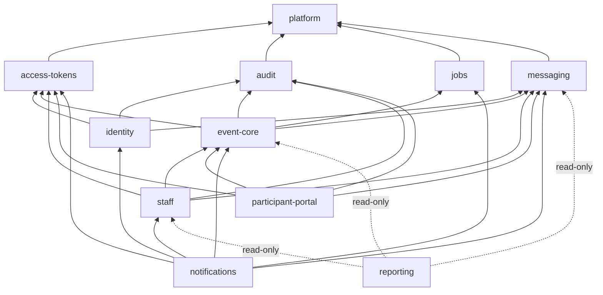

# Backend Modules — Ownership, Interfaces and Dependency Rules

| | |
|---|---|
| **Status** | Phase 1 Architecture Blueprint — approved 2026-10-11 |
| **Requirements baseline** | [REQUIREMENTS.md](../../REQUIREMENTS.md) v1.7 |
| **Related** | [ARCHITECTURE.md](ARCHITECTURE.md) · [ADR index](../adr/README.md) |

Labels are the same as in [ARCHITECTURE.md](ARCHITECTURE.md#how-to-read-this-document): **[Req]**, **[ADR-nnn]**, **[Blueprint]**, **[Proposed: ADR-nnn]** and **[Open]**.

"Owned data" names **logical** data sets. Physical table names, columns and constraints are decided in the database design phase.

---

## 1. Module catalogue

| Module | Responsibility | Owned data (logical) | Label |
|---|---|---|---|
| **`platform`** | Shared kernel with **no business rules**: configuration validation; database access and the transaction runner with bounded retries; **locking-protocol helpers** (`withEventLock`, `withAccountLocks`, outbox-only and single-row transactions); injectable clock; crypto primitives (random generation, hashing); error categories and HTTP mapping; redacting logger; time-zone utilities; HTTP plugins (security headers, `Origin` check, anti-forgery, error mapper); rate-limit counters; `LISTEN/NOTIFY` helper; principal types and the `authorize(tx)` contract | Rate-limit counters; worker heartbeats; schema-version record (written only by `migrate`) | [Blueprint]; heartbeats [Approved: database design] |
| **`identity`** | Organizer accounts, sign-in requests and confirmation, organizer sessions, re-authentication, email change, and the account-scoped locking protocol | Accounts, sign-in requests, email-change requests, organizer sessions | [Req: FR-ORG-1 to FR-ORG-8, NFR-CON-7]; boundary [Blueprint] |
| **`event-core`** | The event and **everything serialized with it**: event lifecycle, registrations, waiting list and promotion, tickets, check-in and undo, reminder slots, schedule rules | Events (with confirmed-count triggers), registrations, tickets, check-ins, check-in request results, reminder slots | [ADR-002] |
| **`access-tokens`** | Every link token: generation, hash-only storage, resolution by hash and route type, revocation, expiry policy, failed-lookup limiting, and **the single generic invalid-link response** | Access tokens (one table) | [ADR-012]; [Req: FR-LNK-1 to FR-LNK-10] |
| **`participant-portal`** | Management-link and share-link use cases: management view, cancellation by link, ticket resend, share-link issuance, share view states, link rotation with request-ID idempotency | Rotation requests | [Req: FR-SELF, FR-SHR, FR-ROT]; boundary [Blueprint] |
| **`staff`** | Staff invitations (issue, re-invite, revoke, expiry), acceptance, staff sessions, staff-access revocation | Staff invitations, staff sessions | [Req: FR-STAFF-1 to FR-STAFF-7] |
| **`messaging`** | Domain-agnostic delivery engine: outbox, two-phase claim, attempts, provider key generations, the NFR-REL-13 state machine, regeneration policy, send budget, sending pause, provider port with Resend and fake adapters, webhook intake, immutable provider-event log, derived delivery facts, sweeps | Outbox messages, attempts, generations and delivery facts, provider-event log, send budget, sending pause | [Req: NFR-REL-1 to NFR-REL-18]; boundary [Blueprint] |
| **`notifications`** | The §4.9 email catalogue in code: per message type, the recipient, **freshness check**, deterministic **renderer** (run after the claim commits, D-2), which links it carries, and **link issuance at send time** (inside the claim); handlers for reminder fan-out and cutoff tasks | None (templates in code) | [Req: §4.9, FR-NTF-1 to FR-NTF-14, NFR-REL-17]; boundary [Blueprint] |
| **`jobs`** | Generic scheduled-task engine: task rows, two-phase claim, leases, attempts | Scheduled tasks | [Req: NFR-CON-4 e, NFR-REL-5] |
| **`audit`** | Append-only audit records and deletion markers, referenced by opaque IDs only, with no foreign keys to events | Audit records, deletion markers | [Req: NFR-SEC-5, FR-EVT-14, NFR-CON-6] |
| **`reporting`** | Dashboard counts, participant list with email-failure flags, deletion-confirmation details, live check-in counts over SSE. **Read-only.** | None | [ADR-021] |

---

## 2. Event-core as the consistency boundary (ADR-002)

`event-core` owns every invariant that NFR-CON-1 and NFR-CON-4 serialize with the event-row lock.

### 2.1 Internal domains

The module is organized into internal domains. It is not one service file.

| Internal domain | Rules it owns |
|---|---|
| `event` | Create, edit, capacity change, reschedule, cancel, delete eligibility [Req: FR-EVT-1 to FR-EVT-14, BR-11 to BR-16, BR-26] |
| `registration` | Submit, resubmit, verify, participant cancellation, re-registration, expiry [Req: FR-REG-1 to FR-REG-12, BR-2, BR-3, BR-10] |
| `waitlist` | FIFO ordering, positions, promotion, waiting-list removal [Req: FR-WL-1 to FR-WL-14, BR-4 to BR-6, BR-24, BR-27] |
| `ticket` | Ticket issuance, code generation, validity [Req: FR-TKT-1 to FR-TKT-5, BR-8, BR-25] |
| `checkin` | Check-in, undo, request-ID idempotency, outcomes [Req: FR-CHK-1 to FR-CHK-9, BR-7] |
| `reminders` | Reminder slots per (registration, schedule version); slot claims in confirm, promote and reschedule transactions; scheduling the fan-out and cutoff tasks [Req: FR-NTF-1 to FR-NTF-3] |
| `schedule` | Pure calculations: cutoff, check-in window, reminder time, DST validation [Req: Glossary, NFR-TIME-1, FR-EVT-3] |

- **Business rules are pure functions** (for example `selectPromotions(snapshot)`). Use cases call them under the event lock **[Req: ENG-CQ-2]**.
- **Internal domains may call each other directly.** This is the reason for having one module: event cancellation must cancel registrations and invalidate tickets, while registration needs event rules. Splitting the module would create cycles **[ADR-002]**.

### 2.2 Public interface

Other modules use only what `event-core/index.ts` exports. Every write operation takes an event-locked transaction of the kind it needs.

| Group | Operations (indicative) | Transaction | Used by |
|---|---|---|---|
| Event lifecycle | create, editDetails, changeCapacity, reschedule, cancelEvent, deleteEvent | `EventTx<'exclusive'>`; create takes no prior event lock | Organizer routes (inside `event-core`) |
| Registration | submit, resubmit, verify, cancelRegistration(by link) | `EventTx<'exclusive'>` | Public routes (inside `event-core`), `participant-portal` |
| Waiting list | removeWaitlisted | `EventTx<'exclusive'>` | Organizer routes |
| Check-in | checkIn, undoCheckIn | `EventTx<'exclusive'>` | Owner and staff routes |
| Ticket | resendTicketRequest | `EventTx<'exclusive'>` | `participant-portal` |
| Reads | getEventForOwner, getRegistrationView, getShareView, waitlistPosition, assertOwner | Read-only | `participant-portal`, `staff`, `notifications`, `reporting` |
| Freshness reads | isMessageStillValid(...) inputs: registration state, event status, schedule version | Inside the caller's claim transaction (`EventTx<'shared'>`) | `notifications` |
| Reminders | claimReminderSlot (insert-only) | `EventTx<'shared'>` or `'exclusive'` | `notifications` (fan-out handler) |

**Authorization re-check under the lock:** use cases that need a caller-specific check after the lock take an `authorize(tx)` callback. Examples are owner-session and staff-session re-checks, and "the token is still valid" for link actions. This keeps `event-core` free of dependencies on `identity`, `staff` and `participant-portal` **[Blueprint; Req: AC-156]**.

### 2.3 What event-core does not do

- **It doesn't send email.** It enqueues logical messages through `messaging` in the same transaction **[Req: NFR-REL-1, BR-18]**.
- **It doesn't store tokens.** It calls `access-tokens` to issue or revoke them **[ADR-012]**.
- **It doesn't render emails or decide freshness rules.** That is `notifications` **[Blueprint]**.
- **It doesn't write audit tables directly.** It calls `audit.record(tx, …)` **[Req: NFR-SEC-5]**.

---

## 3. Allowed dependencies

### 3.1 Graph

| Module | May depend on | Kind of use |
|---|---|---|
| `platform` | — | — |
| `access-tokens` | `platform` | — |
| `audit` | `platform` | — |
| `jobs` | `platform` | — |
| `messaging` | `platform` | — |
| `identity` | `platform`, `access-tokens`, `messaging`, `audit` | Writes through their interfaces |
| `event-core` | `platform`, `access-tokens`, `messaging`, `jobs`, `audit` | Writes through their interfaces |
| `staff` | `platform`, `event-core`, `access-tokens`, `messaging`, `audit` | `event-core`: reads, and the event lock for staff operations |
| `participant-portal` | `platform`, `event-core`, `access-tokens`, `messaging`, `audit` | Calls `event-core` use cases |
| `notifications` | `platform`, `event-core` (read), `identity` (read), `staff` (read), `access-tokens` (issue), `messaging` and `jobs` (implements their handler ports) | Called **by** `messaging` and `jobs` through those ports |
| `reporting` | `platform`, plus read-only SQL over tables of `event-core`, `messaging` and `staff`, and `event-core.assertOwner` | Read-only (ADR-021) |
| `composition/` | Everything | Wiring only: registers handlers and resolvers, builds the apps |
| `entrypoints/` | `composition/` | Starts processes |

The diagram omits the `platform` arrows from layers 2 to 4 for readability. The table above is authoritative.

### 3.2 Acyclicity

The graph is a strict layering. Every edge points from a higher layer to a lower one, so no cycle is possible:

| Layer | Modules |
|---|---|
| 0 | `platform` |
| 1 | `access-tokens`, `audit`, `jobs`, `messaging` |
| 2 | `identity`, `event-core` |
| 3 | `staff`, `participant-portal` |
| 4 | `notifications`, `reporting` |
| 5 | `composition/`, then `entrypoints/` |

Modules in the same layer never depend on each other. `identity` and `event-core` are independent of each other; this is required by NFR-CON-7 (e), because no transaction holds both an event lock and an account-level lock.

---

## 4. Rules that prevent circular dependencies

1. **Imports go through public interfaces only.** A module imports another only through `modules/<name>/index.ts`, and only along the edges in §3.1. Importing another module's internals is forbidden **[Blueprint]**.
2. **Dependency inversion is used in exactly three places** **[Blueprint]**:
   - **Message types:** `messaging` defines the handler port: freshness check, render, recipient, links, class, priority and the required-notice flag. `notifications` implements it for every §4.9 type. Startup fails if any message type has no handler, which supports AC-170.
   - **Scheduled tasks:** `jobs` defines a task-handler port, and `notifications` implements the reminder fan-out and cutoff handlers.
   - **Principals and re-checks:** `platform` defines principal types and the `authorize(tx)` contract. `identity` and `staff` provide principal resolvers, and `composition/` registers them. `event-core` receives a callback, never a module import.
3. **Only `composition/` wires modules together**, and only `entrypoints/` start processes **[Blueprint]**.
4. **No in-process event bus or generic plug-in mechanism.** Modules call each other directly, inside the transaction that needs them **[Req: ENG-CQ-1]**.
5. **Inside a module, layers point one way:** `http` → `app` → `domain`, and `app` → `data`. `domain` is pure: it imports no Fastify, Kysely, `pg`, clock or crypto **[Req: ENG-CQ-2, AC-144]**.
6. **Client areas don't import each other.** They share only `shared/` and the contracts package **[Blueprint]**.
7. **Enforcement:** an import-boundary linter checks rules 1, 3, 5 and 6 in CI **[Req: AC-144]**. The tool choice is blocked by **[Open: OQ-14]**.

## 5. Rules that prevent unauthorized cross-module writes

1. **Single writer per table.** Each table is written only by its owning module's `data/` layer (§1). No other module issues `INSERT`, `UPDATE` or `DELETE` on it **[Blueprint]**.
2. **Cross-module writes are calls, not SQL.** A module that needs another module's state changed calls that module's interface, passing its open transaction. For example, `participant-portal` calls `event-core.cancelRegistration(tx, …)`, which calls `messaging.enqueue(tx, …)` and `audit.record(tx, …)`. Everything commits or rolls back together **[Req: NFR-CON-3, BR-18]**.
3. **Write interfaces require the right transaction type** (`EventTx<'exclusive' | 'shared'>`, `AccountTx`, `OutboxOnlyTx`). A caller can't reach an event-scoped writer without first holding the event lock **[Req: ENG-CQ-2, NFR-CON-4]**; the type design is **[Proposed: ADR-003]**.
4. **`reporting` never writes.** It runs only read-only transactions, and no write path imports it or waits for it **[ADR-021]**.
5. **Outbox-only paths touch only `messaging` and `jobs` rows.** They never lock or modify event, registration, ticket or token rows **[Req: NFR-CON-6]**.
6. **Foreign keys are not writes.** A foreign key from one module's table to another's is allowed where the database design needs it. It gives no write rights.
7. **Database backstops** (to be specified in the database design): append-only tables (audit records, provider-event log) are protected by privileges or triggers, and `reporting` transactions are declared `READ ONLY` **[Proposed: database design]**.

## 6. Cross-module operation examples

| Operation | Transaction | Calls (in order) |
|---|---|---|
| Participant cancels (FR-SELF-2) | `withEventLock(exclusive)` started by `participant-portal` | `access-tokens.resolve` (plain read, before the transaction) → `event-core.cancelRegistration(tx, authorize)` → promotion, if eligible → `messaging.enqueue(tx, registration-cancelled)` and promotion email → `audit.record(tx)` |
| Management rotation (FR-ROT-3, FR-ROT-11) | `withEventLock(exclusive)` started by `participant-portal` | Rotation-request check (own table) → `access-tokens.revokeAllOfType(tx)` → `access-tokens.issue(tx)` → `messaging.enqueue(tx, management-link-replaced)` → `audit.record(tx)` |
| Staff check-in (FR-CHK-2) | `withEventLock(exclusive)` | `event-core.checkIn(tx, authorize = staff session re-check)` → `NOTIFY` check-in count |
| Outbox claim and send (NFR-CON-4 e, D-2) | Pre-claim counter (outbox-only), then `withEventLock(shared)` started by the `messaging` dispatcher | `messaging` claim → `notifications` handler: freshness via `event-core` reads, `access-tokens.issue(tx)` → commit as `SENDING`. Then, outside any transaction: `notifications` renders from a read-only snapshot; `messaging` commits `send_started_at`, calls the provider and writes the result (outbox-only). |
| Reminder fan-out | `withEventLock(shared)` started by `jobs` | `notifications` handler → `event-core.claimReminderSlot(tx)` → `messaging.enqueue(tx, reminder)` |
| Sign-in confirmation (FR-ORG-3 e) | `withAccountLocks` started by `identity` | Address lock → account row → request row → session insert → `audit.record(tx)` |
| Webhook (NFR-REL-15) | Outbox-only, inside `messaging` | Append to event log → match → derive facts; no other module involved |

## 7. Traceability (module → requirements)

| Module | Primary requirements | Key acceptance criteria |
|---|---|---|
| `platform` | NFR-CON-4, NFR-CON-6, NFR-CON-7 (mechanics), NFR-TIME-1 to NFR-TIME-3, NFR-SEC-3, NFR-SEC-7, NFR-SEC-8, ENG-ERR-1 to ENG-ERR-7, ENG-CQ-2, ENG-CI-6, ENG-DOC-2 | AC-85, AC-133, AC-137 to AC-139, AC-141, AC-143, AC-144, AC-157 (b) |
| `identity` | FR-ORG-1 to FR-ORG-8, NFR-CON-7, NFR-SEC-1, §12.2 | AC-146 to AC-150, AC-152, AC-154, AC-155, AC-157 |
| `event-core` | FR-EVT-1 to FR-EVT-14, FR-REG-1 to FR-REG-12, FR-WL-1 to FR-WL-14, FR-TKT-1 to FR-TKT-5, FR-CHK-1 to FR-CHK-9, FR-NTF-1 to FR-NTF-3, BR-1 to BR-18, BR-23 to BR-27, NFR-CON-1 to NFR-CON-5, NFR-PERF-1, NFR-PERF-3, NFR-PERF-4 | AC-1 to AC-29, AC-34 to AC-39, AC-71, AC-76 to AC-81, AC-86 to AC-94, AC-104 to AC-110, AC-118 to AC-124, AC-133 to AC-135 |
| `access-tokens` | FR-LNK-1 to FR-LNK-10, NFR-SEC-1, NFR-SEC-1a, NFR-SEC-1b, BR-19, BR-22, BR-30 | AC-46, AC-50, AC-60, AC-61, AC-66, AC-83, AC-93, AC-102, AC-103, AC-126, AC-173 to AC-178 |
| `participant-portal` | FR-SELF-1 to FR-SELF-4, FR-SHR-1 to FR-SHR-8, FR-ROT-1 to FR-ROT-11, BR-20, BR-21, BR-28 | AC-45 to AC-51, AC-54 to AC-56, AC-58, AC-62 to AC-65, AC-67 to AC-70, AC-72 to AC-75, AC-84, AC-95, AC-113, AC-116, AC-117, AC-125, AC-127 |
| `staff` | FR-STAFF-1 to FR-STAFF-7 | AC-26, AC-82, AC-96, AC-101, AC-111, AC-151, AC-156 |
| `messaging` | NFR-REL-1 to NFR-REL-18, NFR-SEC-9, BR-17, BR-18, BR-29, FR-EVT-10 (c), §12.1, §12.1a | AC-17, AC-18, AC-30, AC-31, AC-98, AC-99, AC-129 to AC-132, AC-136, AC-153, AC-158 to AC-169, AC-171, AC-172 |
| `notifications` | §4.9, FR-NTF-1 to FR-NTF-14, FR-WL-5, FR-WL-8, FR-WL-9, NFR-REL-7, NFR-REL-17 | AC-28, AC-32, AC-33, AC-40 to AC-43, AC-48, AC-52, AC-53, AC-57, AC-59, AC-108, AC-114, AC-161, AC-168, AC-170 |
| `jobs` | NFR-CON-4 (e), NFR-REL-5, FR-NTF-5 | AC-28, AC-108, AC-135 |
| `audit` | NFR-SEC-5, FR-EVT-14, FR-CHK-8, FR-ROT-10, FR-WL-13, FR-ORG-8 | AC-27, AC-100, AC-117, AC-128, AC-154 |
| `reporting` | FR-DSH-1 to FR-DSH-6, NFR-REL-11, NFR-PERF-2 | AC-12, AC-25, AC-53, AC-112, AC-131, AC-171 |
