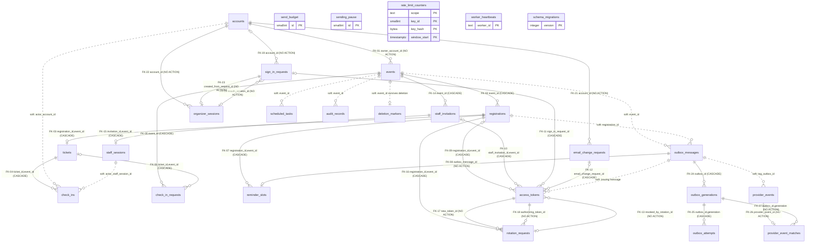
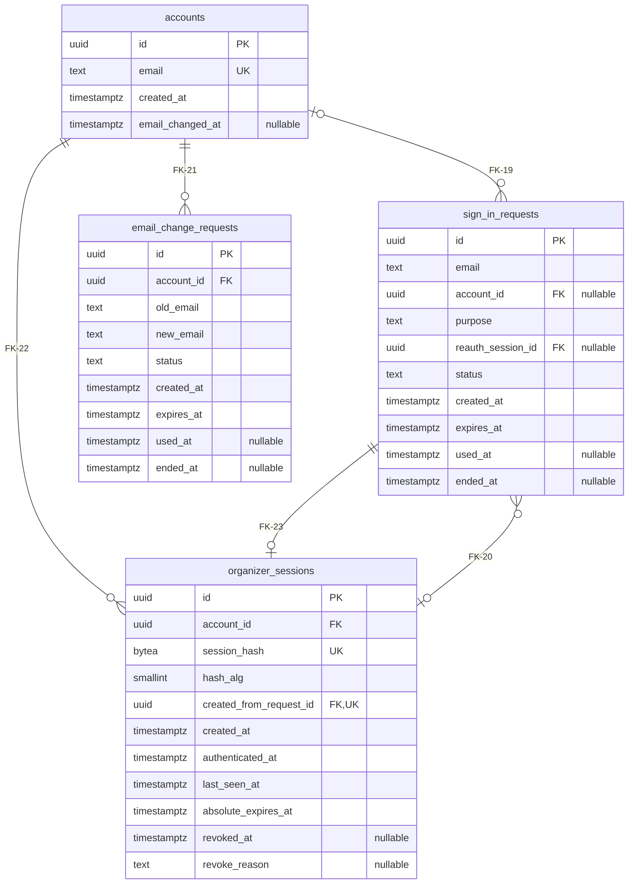
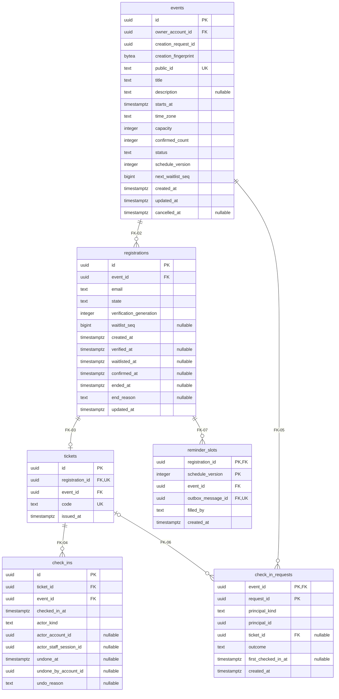
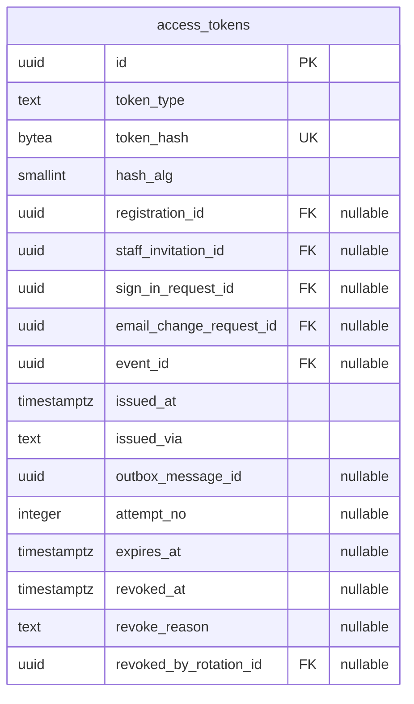
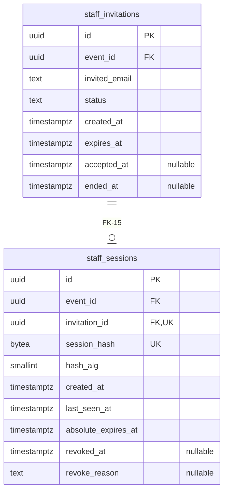
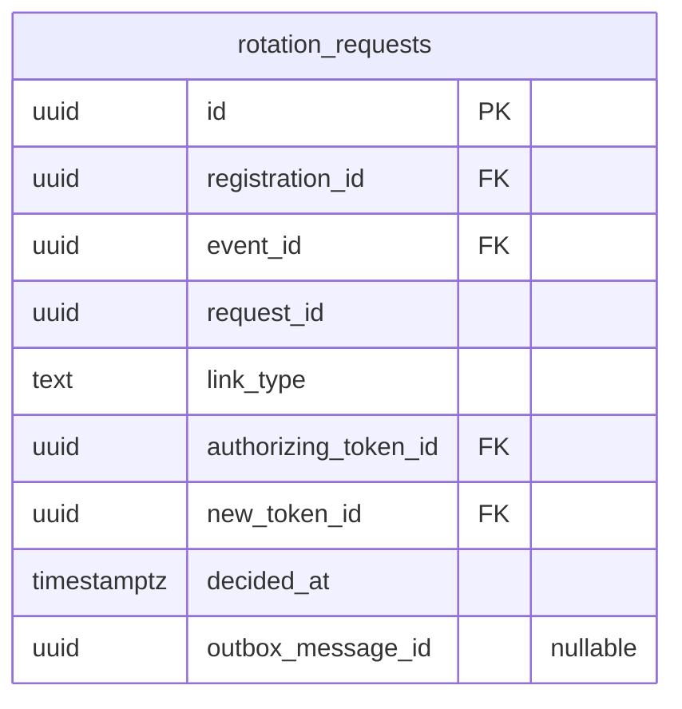
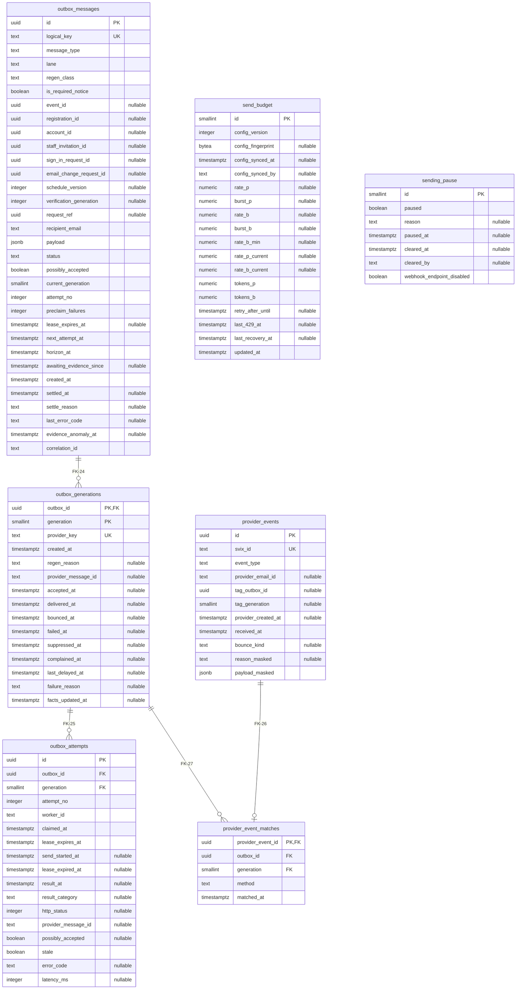
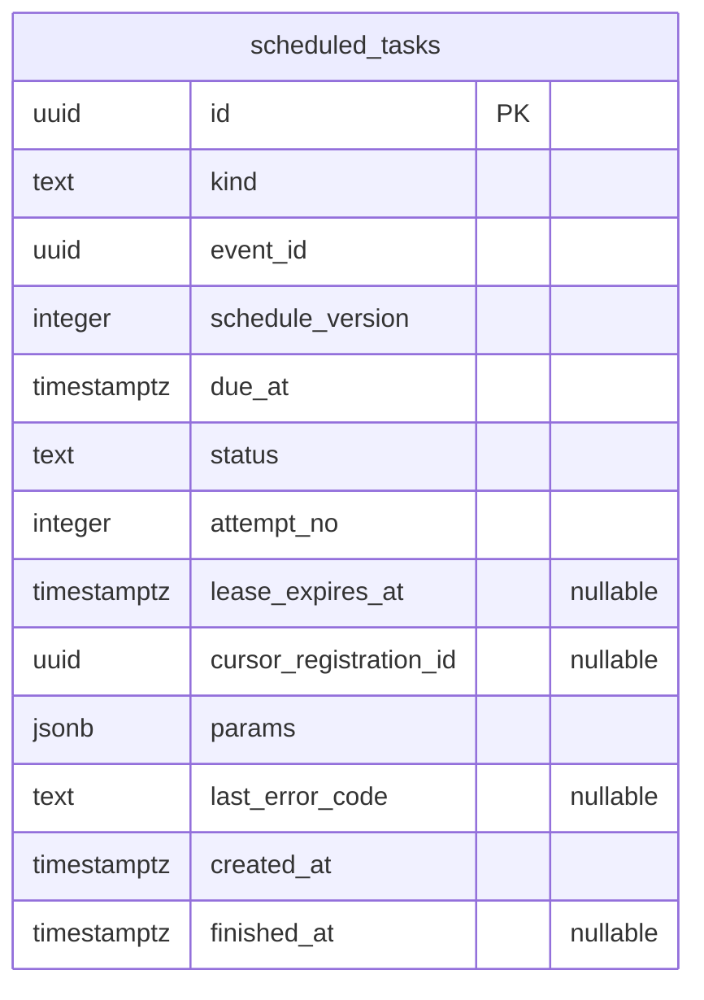
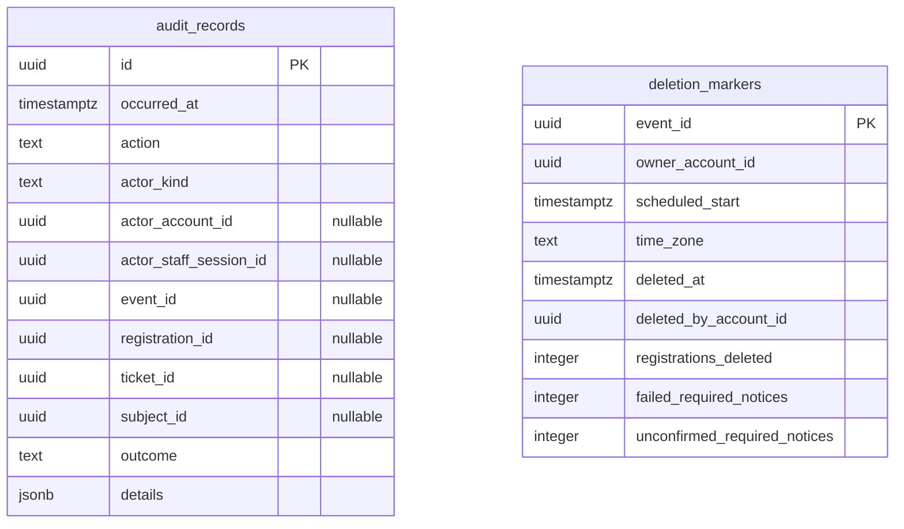
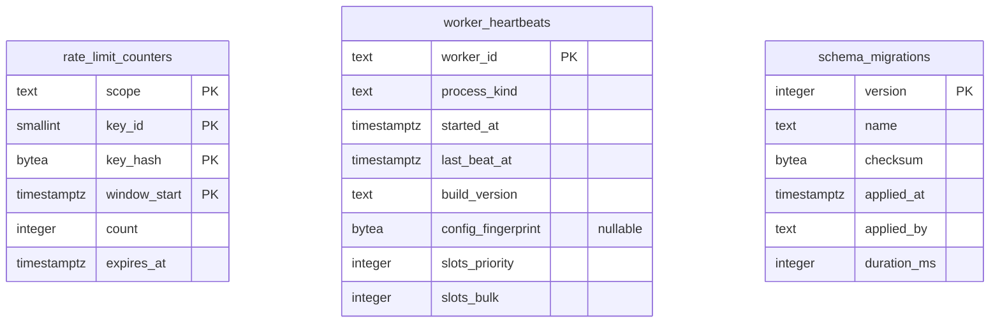

# Entity-Relationship Diagrams

| | |
|---|---|
| **Status** | Database design — see [DATABASE_DESIGN.md](DATABASE_DESIGN.md) for the decision register |
| **Design target** | PostgreSQL 18 |
| **Requirements baseline** | [REQUIREMENTS.md](../../REQUIREMENTS.md) v1.7 |

**How this document is produced:** every diagram is generated from the column tables in [DATABASE_DESIGN.md §5](DATABASE_DESIGN.md#5-table-definitions) and the foreign-key table in [CONSTRAINTS_AND_INDEXES.md §3](CONSTRAINTS_AND_INDEXES.md#3-foreign-keys). Those two documents are authoritative. If a diagram disagrees with them, the diagram is wrong.

**Labels** (as in DATABASE_DESIGN.md):
- **[REQ]** binding requirement;
- **[ARCH]** approved decision;
- **[REC]** recommendation;
- **[OPEN]** / **[RISK]** open item or production risk.

The structure shown is **[REC]**, except where a constraint is marked REQ or ARCH in CONSTRAINTS_AND_INDEXES.md.

## 1. Reading the diagrams

- **Solid lines** are foreign keys. The label gives the FK ID, the child columns and the delete rule.
- **Dotted lines** are **soft references**: an ID column with no foreign key, kept so audit records, deletion markers, outbox rows and tasks survive event deletion. **[REQ: NFR-CON-6; ARCH: D-8]**
- **Cardinality:** `||--o|` means a parent has at most one child (a unique constraint on the child's foreign-key columns). `||--o{` means many children. `|o` on the parent side means the child's foreign-key column is nullable.
- **Rules a diagram can't express** (DATABASE_DESIGN.md and CONSTRAINTS_AND_INDEXES.md):
  - **[REQ]** "Exactly one ticket per `CONFIRMED` registration" (§2.2). U-11 enforces "at most one" in the database. "At least one" is enforced by the verify and promotion transactions and checked by reconciliation.
  - **[REQ]** At most one **active** check-in per ticket (U-13, a partial unique index).
  - **[ARCH: ADR-012]** Exactly one owner reference per access token, matching its type (CK-35).
  - **[ARCH: D-12]** Send-state invariants (CK-50 to CK-55, TR-08).

## 2. Overview: all tables and relationships

Solid lines are foreign keys (label = FK ID). Dotted lines are soft references with no foreign key (DATABASE_DESIGN §3).

## 3. Tables by owning module

Every column is listed. `PK`, `FK` and `UK` (single-column unique, no predicate) are marked; composite and partial unique constraints are in [CONSTRAINTS_AND_INDEXES.md §2](CONSTRAINTS_AND_INDEXES.md#2-unique-constraints-and-unique-indexes).

### 3.1 identity

Cross-module foreign keys: FK-01 `events` → `accounts`; FK-11 `access_tokens` → `sign_in_requests`; FK-12 `access_tokens` → `email_change_requests`.

### 3.2 event-core

Cross-module foreign keys: FK-01 `events` → `accounts`; FK-08 `reminder_slots` → `outbox_messages`; FK-09 `access_tokens` → `registrations`; FK-14 `staff_invitations` → `events`; FK-16 `rotation_requests` → `registrations`.

### 3.3 access-tokens

Cross-module foreign keys: FK-09 `access_tokens` → `registrations`; FK-10 `access_tokens` → `staff_invitations`; FK-11 `access_tokens` → `sign_in_requests`; FK-12 `access_tokens` → `email_change_requests`; FK-13 `access_tokens` → `rotation_requests`; FK-17 `rotation_requests` → `access_tokens`; FK-18 `rotation_requests` → `access_tokens`.

### 3.4 staff

Cross-module foreign keys: FK-10 `access_tokens` → `staff_invitations`; FK-14 `staff_invitations` → `events`.

### 3.5 participant-portal

Cross-module foreign keys: FK-13 `access_tokens` → `rotation_requests`; FK-16 `rotation_requests` → `registrations`; FK-17 `rotation_requests` → `access_tokens`; FK-18 `rotation_requests` → `access_tokens`.

### 3.6 messaging

Cross-module foreign keys: FK-08 `reminder_slots` → `outbox_messages`.

### 3.7 jobs

### 3.8 audit

### 3.9 platform

## 4. Lifecycle notes

| Relationship | Lifecycle rule | Label |
|---|---|---|
| `events` → event-owned rows | Deleting an eligible event cascades to registrations, tickets, check-ins, check-in requests, reminder slots, event-scoped tokens, staff invitations and sessions, and rotation requests (FR-EVT-10). Outbox rows, tasks, provider events, audit records and the deletion marker remain. | [REQ: FR-EVT-10, FR-EVT-14, NFR-CON-6]; [ARCH: D-8] |
| `registrations` → `tickets` | Created by verification or promotion; never deleted on cancellation, so a scan can return `TICKET_CANCELLED` | [REQ: BR-8, FR-CHK-4] |
| `tickets` → `check_ins` | Check-in inserts a row; undo closes it; a new check-in inserts a new row | [REC] (DATABASE_DESIGN §8) |
| `outbox_messages` → `outbox_generations` | Generation 1 is created at the message's first claim (TX-M01), so enqueue writes one row per message. Generation 2 is created only by a class B regeneration (TX-M08). | [REQ: NFR-REL-16] |
| `provider_events` → `provider_event_matches` | The event is inserted once (deduplicated by `svix-id`); the match is inserted when known, possibly later | [REQ: NFR-REL-15] |
| Accounts | Rows referencing accounts use `NO ACTION`. Account deletion is undecided. | [OPEN: OQ-17] |
| Retention | No purge relationships are designed yet | [OPEN: OQ-5] |
