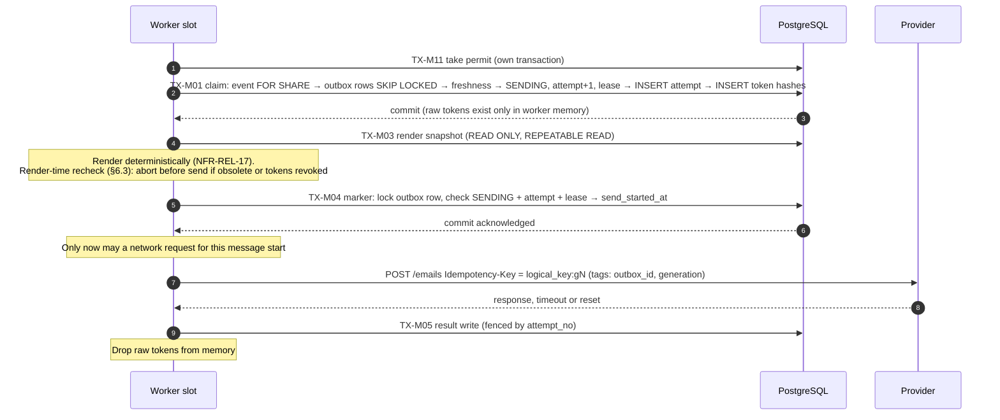

# Transactions, Locking and Time Semantics

| | |
|---|---|
| **Status** | Database design — see [DATABASE_DESIGN.md](DATABASE_DESIGN.md) for the decision register |
| **Design target** | PostgreSQL 18, `READ COMMITTED` (NFR-CON-4 a, NFR-CON-7 a) |
| **Requirements baseline** | [REQUIREMENTS.md](../../REQUIREMENTS.md) v1.6 |

**Labels:**
- **[REQ]** binding requirement;
- **[ARCH]** approved decision (ADR or D-n);
- **[REC]** design recommendation;
- **[OPEN]** pending decision;
- **[RISK]** production risk.

---

## 1. Principles

1. **The locking protocols themselves are binding:** NFR-CON-4 (event-scoped), NFR-CON-6 (outbox-only) and NFR-CON-7 (account-scoped) **[REQ]**. This document maps every operation onto them.
2. **No external call happens inside a transaction** **[REQ: NFR-CON-4 g]**.
3. **Deadlock, serialization and lock-timeout failures** (`40P01`, `40001`, `55P03`) are retried a bounded number of times, with jitter **[REQ: NFR-CON-4 h, ENG-ERR-7]**. Other errors are never retried by the transaction runner.
4. **Every deadline comparison uses the transaction's decision time** (§2) **[ARCH: D-1]**.

## 2. Time semantics (D-1)

### 2.1 Definition **[ARCH: D-1]**

- **Decision time (`T`):** the value of `app.decision_time()` (`clock_timestamp()` on the database server) read by **the first statement after the transaction has acquired its serialization lock**. Each kind of transaction defines its own serialization lock:
  - event-scoped: the event-row lock;
  - account-scoped: the account-level locks;
  - outbox-only: the single row it locks;
  - transactions with no lock: the start of the statement.
- **Read exactly once per transaction**, then passed as a parameter to every later statement and stored wherever a timestamp column records the decision (`confirmed_at`, `created_at`, `issued_at`, `decided_at`, and so on).
- **`now()` is never used for decisions.** It returns the transaction start time, which comes **before** any lock wait.

### 2.2 What decision time is, and is not

| Property | Holds? | Explanation |
|---|---|---|
| `T` equals the commit timestamp | **No** | PostgreSQL can't expose a transaction's own commit time inside the transaction. `T` comes before the commit by the remaining duration of the transaction. **[ARCH: D-1 correction]** |
| `T ≤` commit time | Yes | `T` is read before `COMMIT` |
| Commit time − `T` ≤ the transaction's remaining duration | Yes | Bounded by `statement_timeout` and the transaction's work. Typically milliseconds for interactive transactions; see §8 for large ones. |
| Exclusive transactions on the same event have the same order of `T` as of commit | Yes | Transaction B can take the event lock only after A commits, so `T_B > commit_A ≥ T_A`. |
| A shared transaction and an exclusive transaction on the same event are ordered the same way | Yes | Same argument: each waits for the other to commit |
| Two shared transactions on the same event are ordered | No | They don't serialize against each other (NFR-CON-1). No rule depends on their order. |
| Monotonic if the server clock steps backwards | No | **[RISK-3]** The database host needs slewing time synchronization (OQ-2) |

### 2.3 Deadline rules **[ARCH: D-1]**

| Deadline | Anchor (stored) | Rule, with `T` = decision time of the checking transaction | Requirement |
|---|---|---|---|
| Sign-in link validity | `sign_in_requests.expires_at = created_at + 15 min` | Valid iff `T < expires_at` | FR-ORG-3 c, e |
| Email-change link validity | `email_change_requests.expires_at = created_at + 15 min` | Valid iff `T < expires_at` | FR-ORG-6 |
| Authentication message claimable | Request `expires_at` | Claim iff `T + 2 min <= expires_at` | NFR-REL-12 c |
| Verification link | `access_tokens.expires_at = issued_at + 24 h` (configurable), plus the computed cutoff | Valid iff `T < least(expires_at, starts_at − 2 h)` | FR-REG-3, FR-REG-11 |
| Registration and verification open | Computed cutoff | Open iff `T < starts_at − 2 h` | BR-9, FR-REG-10 |
| Promotion allowed | Computed cutoff | Iff `T < starts_at − 2 h` | FR-WL-4 |
| Reminder slot taken by a ticket or promotion email | `registrations.confirmed_at = T` | Slot iff `T >= starts_at − 24 h` (**inclusive**, so exactly Start − 24 h counts as within) | FR-NTF-2, AC-38, EC-41 |
| Participant cancellation allowed | Computed | Iff `T < starts_at` | BR-10 |
| Check-in accepted | Computed window | Iff `starts_at − 2 h <= T <= starts_at + 12 h` | FR-CHK-5 |
| Management and share token validity | Computed window end | Valid iff `T < starts_at + 12 h` (current schedule) | FR-LNK-5 |
| Staff invitation | `staff_invitations.expires_at = created_at + 168 h` | Valid iff `T < expires_at` and `T < starts_at + 12 h` | FR-STAFF-5, AC-96 |
| Organizer and staff session | `absolute_expires_at`, `last_seen_at` | Valid iff `T < absolute_expires_at` and `T < last_seen_at + 168 h` (staff also `T < starts_at + 12 h`) | FR-ORG-4, D-4 |
| Recent authentication | `organizer_sessions.authenticated_at` | Iff `T < authenticated_at + 15 min` | FR-ORG-5 |
| Rotation retry window | `rotation_requests.decided_at` | "Already replaced" iff `T < decided_at + 15 min` | FR-ROT-11 a, AC-95 |
| Lease | `outbox_messages.lease_expires_at = T_claim + lease` | Expired iff `T > lease_expires_at` | NFR-REL-9 |
| Retry horizon | `outbox_messages.horizon_at` | Settles when `T >= horizon_at` | NFR-REL-4 |

**[REC]** Durations are written in minutes or hours, never days, so `timestamptz` arithmetic is exact in UTC (DATABASE_DESIGN §3).

**Effective validity:** a request or link created at decision time `T0` becomes visible to other transactions only at commit, `C0 ≥ T0`. Its usable window is therefore `expires_at − C0`, which is **shorter** than the nominal duration by `C0 − T0`. This is conservative: a link is never valid longer than specified. R59 (AL-3) aligned the requirement wording with this.

### 2.4 Injected clock **[REC]**

`app.decision_time()` (FN-01) returns `clock_timestamp()`. In test databases only, where the database-level setting `app.test_clock = on`, it adds a per-session offset. This makes AC-38, AC-96, AC-102 and AC-148 testable without sleeping (ENG-TST-6). Production databases never have the setting.

### 2.5 Requirement wording (applied as R59 / AL-3, classified as behavioral alignment)

These texts used to say "commit time" or "committed" and now use the decision time. Because the observable boundary moves (by at most the transaction time limit), the change is **behavioral**, not editorial:
- Glossary "Sign-in request";
- FR-ORG-3 (c) and (e);
- FR-ORG-6;
- FR-NTF-2 (a) and (b);
- FR-ROT-11 (a);
- AC-147.

NFR-TIME-2 now names the **database server** clock and requires a bounded transaction duration. **Not changed:** "start of sending" (glossary, BR-16) and BR-23. They're defined by **commit order**, which the locks implement exactly; they don't need a timestamp.

### 2.6 Boundary cases with long transactions **[ARCH: D-1]**

`L` is the configured transaction time limit (PostgreSQL 17+ `transaction_timeout`, set per transaction class, §3). Every transaction that evaluates a deadline commits within `L` of its decision time, or is rolled back.

| Case | What happens | Consequence |
|---|---|---|
| A verification decided at `cutoff − ε` commits at up to `cutoff − ε + L` | Accepted: it was decided before the cutoff (AC-182, EC-102) | A registration can become visible up to `L` after the cutoff. The cutoff task (TX-J03, exclusive) is serialized with it: it runs either before (and then the verification sees `T ≥ cutoff` and is rejected) or after (and then it sees the confirmed registration). Nothing falls between them. |
| Confirmation at `Start − 24 h ± ε` vs. the reminder fan-out (shared lock) | They are serialized through the event lock. A fan-out batch that ran first means the confirmation's `T` comes after it, so `T ≥ Start − 24 h` and the confirmation takes the slot itself. A confirmation that ran first with `T < Start − 24 h` leaves the slot empty, and the later batch fills it. | Exactly one slot claim in every order (CT-19) |
| Sign-in confirmation decided at `expires_at − ε` | Succeeds; the session becomes visible up to `L` after the nominal expiry | Bounded by `L`; FR-ORG-3's usable window was already conservative |
| A request created at `T0` and committed at `C0` | Usable from `C0` to `expires_at = T0 + 15 min` | The window is shorter than nominal by `C0 − T0 ≤ L`, never longer |
| A large owner transaction (TX-E04, TX-E05) decided before Start, committing after Start | Allowed: the decision was before Start | Bounded by that class's `L` (§3). PT-1 and PT-2 measure real durations. |
| Two shared-lock transactions on one event (claims, fan-out) | Their decision-time order may differ from their commit order | No rule depends on it (Glossary "Decision time") |
| A clock step on the database server | Decision times may go backwards | RISK-3 |

---

## 3. Transaction classes

| Class | First statement after `BEGIN` and `SET LOCAL` | Then | Label |
|---|---|---|---|
| **EX** event, exclusive | `SELECT id, status, starts_at, schedule_version, capacity, confirmed_count, next_waitlist_seq FROM app.events WHERE id = $1 FOR UPDATE` | `SELECT app.decision_time()` | [REQ: NFR-CON-4 a] |
| **SH** event, shared | `SELECT id, status, starts_at, schedule_version FROM app.events WHERE id = ANY($1) ORDER BY id FOR SHARE` (one event per claim recommended) | `SELECT app.decision_time()` | [REQ: NFR-CON-4 a, e] |
| **ACC** account-scoped | `SELECT pg_advisory_xact_lock(<ns>, hashtext(email))` for each address, ascending key | Account row `FOR UPDATE`, then decision time, then request and session rows | [REQ: NFR-CON-7 b] |
| **OUT** outbox-only | One outbox or task row `FOR UPDATE`, or a batch `FOR UPDATE SKIP LOCKED` in ID order | Decision time | [REQ: NFR-CON-6] |
| **ROW** isolated single row | That row (budget, pause, counter, session last-seen, heartbeat) | — | [REQ: NFR-REL-14 c, NFR-CON-7 g] |
| **RO** read-only | `BEGIN READ ONLY` (`REPEATABLE READ` where one snapshot is needed) | — | [ARCH: ADR-021]; [REC] |
| **NEW** creation | No existing event to lock (event creation only) | Decision time | [REC] (§4.3) |

**Timeouts** **[REC]**:
- Every transaction sets `lock_timeout`, `statement_timeout` and `transaction_timeout` with `SET LOCAL`. `transaction_timeout` is the time limit `L` of NFR-TIME-2 (§2.6). `SET` takes no table lock, so AC-133's "no `RowExclusiveLock` before the event lock" still holds.
- Proposed defaults: interactive EX and SH `lock_timeout` 5 s; large owner operations (TX-E04, TX-E05, TX-E06) `statement_timeout` 60 s.
- Sessions use `idle_in_transaction_session_timeout` 30 s.
- Final values are set after the performance tests (§10).

## 4. Lock ordering

### 4.1 Event-scoped **[REQ: NFR-CON-4]**

1. Plain, non-locking lookups (token hash → event, ticket code → event, public ID → event) happen **before** `BEGIN` (NFR-CON-4 b).
2. The event row(s): `FOR UPDATE` or `FOR SHARE`, ascending ID. **No upgrade** from shared to exclusive (NFR-CON-4 c).
3. Then any rows of that event, in any order (NFR-CON-4 d): registrations, tickets, check-ins, tokens, reminder slots, rotation requests, staff rows, and outbox or task rows (claims, deletion).
4. Statements that lower the confirmed count or raise capacity run before statements that raise the confirmed count (NFR-CON-4 f).

### 4.2 Account-scoped **[REQ: NFR-CON-7]**

1. Advisory locks for every normalized address involved (`pg_advisory_xact_lock(<namespace int4>, hashtext(email))`), ascending key. A hash collision only adds serialization.
2. The account row `FOR UPDATE`, if it exists. For first-time creation: `INSERT … ON CONFLICT (email) DO NOTHING`, then a read.
3. Sign-in request, email-change request and session rows.
4. If an assumption from the plain read no longer holds, **roll back and restart** (bounded). A unique violation is handled the same way.
5. **Never** combined with an event lock (NFR-CON-7 e). Sign-out everywhere and single-session revocation start at level 2.

### 4.3 Foreign-key-induced locks

Inserting or updating a referencing row takes `FOR KEY SHARE` on the referenced row. **[REC]** analysis:

| Path | Key-share lock taken on | Why it is safe |
|---|---|---|
| Any EX or SH transaction inserting registrations, tickets, check-ins, slots, tokens, rotations or staff rows | Rows of the **same** event (registration, ticket, invitation) or the event row itself | Already covered by the event lock, and taken after it (§4.1) |
| SH claim issuing email tokens (TX-M01) | Registration or invitation rows of the locked event | Taken after the event lock |
| Auth claim issuing tokens (TX-M02) | Request row, already held `FOR SHARE` (NFR-CON-7 f) | Same row, already locked |
| Slot insert (FK-08, deferred) | The outbox row, inserted in the same transaction | Not yet visible to anyone else |
| Outbox-only status updates | — (they update non-key columns: `FOR NO KEY UPDATE`) | Compatible with `FOR KEY SHARE` |
| **TX-E01 event creation** (FK-01) | The owner's **account row** | The transaction holds **no event lock** (the new row is invisible to others). It may wait on an account-scoped transaction holding the account row, but those never wait on events. No cycle. This satisfies NFR-CON-7 (e), whose concern is a transaction holding both an event lock and an account-level lock. |

No event-scoped table has any other foreign key to an identity table (CONSTRAINTS_AND_INDEXES §3, identity-lock rule).

### 4.4 Deadlock-freedom argument

| Pair | Order | Result |
|---|---|---|
| EX/SH vs. EX/SH, same event | Both take the event row first | Serialized; no cycle |
| Multi-event SH claim vs. others | Ascending event ID | No cycle |
| Event-scoped vs. outbox-only | Event-scoped may wait on an outbox row (claims, deletion); outbox-only paths hold only outbox or task rows and never wait on event rows | No cycle (NFR-CON-6) |
| Event-scoped vs. account-scoped | Disjoint lock sets, except TX-E01 (§4.3) | No cycle |
| Auth claim vs. account writer | Claim: outbox row → request row (`FOR SHARE`). Writer: request row, never outbox. | No cycle (NFR-CON-7 f) |
| Single-row paths | One row each | No cycle |
| Confirmed-count trigger | Locks event rows ascending; inside EX transactions they are already held | No new lock |

Verified by AC-133, AC-135 and AC-157, and the tests in §10.

---

## 5. Transaction catalogue

Columns:
- **Cls:** class from §3.
- **Writes:** in statement order.
- **AC-133:** the transaction is one of the paths that AC-133 must test.

| TX | Operation | Module | Cls | Steps after the lock and decision time (writes in order) | Trace | AC-133 |
|---|---|---|---|---|---|---|
| TX-E01 | Create event | event-core | NEW | Validate (start > `T`, zone, DST). INSERT `events`. INSERT two `scheduled_tasks` (fan-out due `starts_at − 24 h`, cutoff due `starts_at − 2 h`). | FR-EVT-1 to FR-EVT-4, EC-33 | — |
| TX-E02 | Edit title or description | event-core | EX | Owner re-check (`authorize`). UPDATE `events`. No email. | FR-EVT-5, AC-105 | yes |
| TX-E03 | Change capacity | event-core | EX | Decrease: reject if `new < confirmed_count` (conflict with the minimum). Increase: UPDATE `capacity` **first**; if `T < cutoff`, promote FIFO (UPDATE registrations → `CONFIRMED`, INSERT tickets, slot if `T >= starts_at − 24 h`, INSERT promotion outbox). INSERT audit. | FR-EVT-7, FR-EVT-8, BR-5, NFR-CON-4 f | yes |
| TX-E04 | Reschedule | event-core | EX | Validate (`T < starts_at`, new start > `T`). UPDATE `starts_at`, `schedule_version + 1`. INSERT `event_change` outbox for every `CONFIRMED` and `WAITLISTED` registration (payload marks "registration closed" if `T >=` new cutoff, FR-NTF-4). If `T >= new start − 24 h`, INSERT slots (new version) for confirmed, filled by `event_change` (FR-NTF-3). INSERT new-version tasks (`params.waitlist_closed_by_change` when FR-NTF-4 applies). If `T <` new cutoff, promote into free seats (BR-15, AC-107). INSERT audit. | FR-EVT-6, BR-12 to BR-15, FR-NTF-2d | yes |
| TX-E05 | Cancel event | event-core | EX | Recent-authentication re-check. UPDATE `events` (status, `cancelled_at`, version + 1). UPDATE registrations: `CONFIRMED`/`WAITLISTED` → `CANCELLED (event_cancelled)`, `PENDING_VERIFICATION` → `EXPIRED (event_cancelled)` (D-3), in one statement. INSERT `event_cancellation` outbox for the previously confirmed and waitlisted. UPDATE pending `staff_invitations` → `revoked`, and their tokens. INSERT audit. Pending messages are **not** touched; they are settled at claim. | FR-EVT-9, BR-16, FR-STAFF-5, AC-18, AC-59 | yes |
| TX-E06 | Delete event | event-core | EX | Recent-authentication re-check. Eligibility: `SCHEDULED`; `confirmed_count = 0`; no `WAITLISTED` (IX-06); no pending required notice (IX-24). Count registrations deleted, and required notices as failed or unconfirmed (FR-EVT-14, DATABASE_DESIGN §5.8 counting rule). Settle pending non-required messages of the event in `QUEUED`/`WAITING_RETRY`: `DROPPED` or `UNCONFIRMED (event_deleted)` by `possibly_accepted` (D-12). INSERT `deletion_markers`. INSERT audit. Explicit ordered child deletes (§8.4), then DELETE `events`. | FR-EVT-10, FR-EVT-13, FR-EVT-14, BR-29, AC-87, AC-98 | yes |
| TX-R01 | Submit or resubmit a registration | event-core | EX | Reject if `T >= cutoff` or the event is cancelled. Look up the active registration (U-08). None → INSERT `PENDING_VERIFICATION` and a `verification` outbox. Pending → `verification_generation + 1`, revoke its active verification tokens (`resubmitted`), INSERT a `verification` outbox. Confirmed or waitlisted → INSERT an `existing_access` outbox. Every path writes one outbox row, keeping the shape uniform (NFR-SEC-2). | FR-REG-2, FR-REG-7, FR-REG-8, FR-REG-10 | yes |
| TX-R02 | Verify (confirmation submit) | event-core | EX | Re-validate the token (§5.3 of DATABASE_DESIGN). Registration not pending, token still within its window → "Already confirmed", no write. Seat free → UPDATE → `CONFIRMED` (`confirmed_at = T`), INSERT ticket, INSERT management and share page tokens, INSERT `ticket_confirmation` outbox, slot if `T >= starts_at − 24 h`. Full → `waitlist_seq = next_waitlist_seq`, UPDATE the event counter, UPDATE → `WAITLISTED`, INSERT management page token, INSERT `waitlist_confirmation` outbox (position snapshot in the payload). | FR-REG-4, FR-REG-5, FR-REG-11, FR-NTF-2, EC-1, AC-4, AC-81 | yes |
| TX-R03 | Participant cancels | participant-portal → event-core | EX | Re-validate the management token. Require `T < starts_at`, no active check-in (U-13), and state `CONFIRMED` or `WAITLISTED`. UPDATE → `CANCELLED (participant_cancelled)` **first** (decrement). If it was `CONFIRMED` and `T < cutoff`: promote the head (UPDATE, INSERT ticket, slot rule, INSERT `promotion` outbox). INSERT `registration_cancelled` outbox (required). INSERT audit. | FR-SELF-2, FR-WL-2, BR-23, AC-8, AC-71 | yes |
| TX-W01 | Waiting-list removal | event-core | EX | Owner re-check. Require state `WAITLISTED` (else reject). UPDATE → `CANCELLED (removed_by_organizer)`. INSERT `waitlist_removed` outbox (required). INSERT audit. No promotion. | FR-WL-10 to FR-WL-14, BR-24, BR-27 | yes |
| TX-C01 | Check-in | event-core | EX | Replay: existing `check_in_requests` row → same principal ⇒ return the stored outcome; different principal ⇒ reject (D-5). `authorize` re-check of the staff or owner session (AC-156). Outcome in order: unknown code → `INVALID_CODE`; ticket of another event → `WRONG_EVENT`; event cancelled → `EVENT_CANCELLED`; registration not confirmed → `TICKET_CANCELLED`; `T` outside the window → `OUTSIDE_CHECK_IN_WINDOW`; otherwise INSERT `check_ins … ON CONFLICT DO NOTHING` (U-13) → `CHECKED_IN` or `ALREADY_CHECKED_IN`. INSERT `check_in_requests`. TR-07 notifies on commit. | FR-CHK-1 to FR-CHK-5, BR-7, AC-22, AC-23 | yes |
| TX-C02 | Undo check-in | event-core | EX | Owner re-check. UPDATE the active `check_ins` row's undo columns (TR-06). INSERT audit. TR-07 notifies. | FR-CHK-8, AC-27 | yes |
| TX-P01 | Ticket resend | participant-portal | EX | Rate limit checked before (TX-X01). Re-validate the token; registration `CONFIRMED`; event `SCHEDULED`. INSERT `ticket_resend` outbox `ON CONFLICT (logical_key) DO NOTHING`. | FR-SELF-4, FR-NTF-2c | yes |
| TX-P02 | Share-link issuance | participant-portal | EX | Re-validate; `CONFIRMED`. INSERT a share page token. | FR-SHR-1, FR-LNK-2 | yes |
| TX-P03 | Link rotation | participant-portal | EX | Rate limit before. Existing `rotation_requests` row (U-20) → outcome (a), (b) or (c) of FR-ROT-11, no write. Otherwise re-validate the authorizing token and FR-ROT-1 availability; INSERT the new token; INSERT `rotation_requests` (`decided_at = T`); UPDATE all other unrevoked tokens of that type (`rotated`, `revoked_by_rotation_id`); management only: INSERT a `management_link_replaced` outbox. INSERT audit. | FR-ROT-1 to FR-ROT-11, BR-20, AC-65, AC-72, AC-75 | yes |
| TX-S01 | Staff invite or re-invite | staff | EX | Owner re-check. UPDATE the existing pending invitation for the same address → `replaced`, and revoke its tokens. INSERT the invitation (`expires_at = T + 168 h`). INSERT a `staff_invitation` outbox. INSERT audit. | FR-STAFF-1, FR-STAFF-5 | yes |
| TX-S02 | Accept invitation | staff | EX | Re-validate the token (§5.3 of DATABASE_DESIGN). UPDATE invitation → `accepted`. INSERT `staff_sessions`. INSERT audit. The cookie is set after commit. | FR-STAFF-1, FR-STAFF-2, AC-82, AC-96 | yes |
| TX-S03 | Revoke an invitation or staff session | staff | EX | Owner re-check. UPDATE invitation → `revoked`, and its tokens; and/or UPDATE `staff_sessions.revoked_at`. INSERT audit. | FR-STAFF-3, AC-111, AC-156 | yes |
| TX-J01 | Claim a scheduled task | jobs | SH | Two-phase (§7.2). UPDATE task → `RUNNING`, `attempt_no + 1`, lease. | NFR-CON-4 e | yes |
| TX-J02 | Reminder fan-out batch | notifications → event-core | SH | Lock the task row (fenced by `attempt_no`). If the version isn't current or the event is cancelled → task `SKIPPED`. If `T >= starts_at` → `SKIPPED`, logged (FR-NTF-5). Otherwise, for up to N `CONFIRMED` registrations after the cursor: INSERT slots `ON CONFLICT DO NOTHING RETURNING`, then INSERT `reminder` outbox for the claimed ones. UPDATE the task cursor and lease; `DONE` when exhausted. | FR-NTF-1, FR-NTF-2b, AC-28, AC-35, AC-108 | yes |
| TX-J03 | Cutoff processing | notifications → event-core | **EX** (it changes registration state; a separate transaction from the TX-J01 claim, because locks are never upgraded) | Verify the task attempt and version. UPDATE `PENDING_VERIFICATION` → `EXPIRED (cutoff)` (D-3). Unless `params.waitlist_closed_by_change`, INSERT `waitlist_closed` outbox for every `WAITLISTED`. UPDATE task → `DONE`. | FR-WL-5, FR-NTF-4, F8, AC-32 | yes |
| TX-M01 | Outbox claim (event messages) | messaging + notifications | SH | Preceded by TX-M14. Two-phase (§7.2). Per message, inside a **savepoint**: run the freshness check (notifications handler). If it fails → `DROPPED`, or `UNCONFIRMED (obsolete)` if `possibly_accepted` (D-12). Otherwise: INSERT generation 1 if missing; UPDATE → `SENDING`, `attempt_no + 1`, `lease_expires_at = T + lease`; INSERT `outbox_attempts`; INSERT email tokens (§6.4). An exception rolls back to the savepoint, and the message is recorded as a failed attempt. Every message decided in the committed claim gets `preclaim_failures = 0`. | NFR-CON-4 e, FR-LNK-3, BR-16, AC-17, AC-18 | yes |
| TX-M02 | Authentication message claim | messaging | OUT, then the request row `FOR SHARE` | Candidates `FOR UPDATE SKIP LOCKED` (ID order); request row `FOR SHARE`. Replaced → `DROPPED`/`UNCONFIRMED (obsolete)`. Less than 2 minutes left → `FAILED`/`UNCONFIRMED (link_expiry)`. Otherwise claim as TX-M01. | NFR-CON-7 f, NFR-REL-12 c, AC-153 | — |
| TX-M03 | Render snapshot | notifications | RO (`REPEATABLE READ`) | Read the event, registration, ticket code, payload snapshot and the issued tokens' revocation status (§6.3) | FR-NTF-8, NFR-REL-17 | — |
| TX-M04 | Send-start marker | messaging | OUT | Lock the outbox row; require `status = 'SENDING'`, the same `attempt_no`, and `lease_expires_at > T + provider_timeout + margin`. UPDATE `outbox_attempts.send_started_at = T`. **Commit before** the provider request. | D-2 | — |
| TX-M05 | Result write | messaging | OUT | Lock the outbox row, then the attempt row. Record the result on the attempt (TR-10). If `attempt_no` matches and status is `SENDING`: apply the NFR-REL-13 mapping. Otherwise (stale): only forward moves (a `200` → `ACCEPTED`). Record the provider ID on the generation, and re-match unmatched events with that ID (§6.6). | NFR-REL-9, NFR-REL-13, AC-129, AC-165 | outbox-only |
| TX-M06 | Lease reaper (outbox and tasks) | messaging, jobs | OUT (batch `SKIP LOCKED`) | `SENDING` with an expired lease → set `lease_expired_at`; `possibly_accepted = true` **only if** `send_started_at` is set; → `WAITING_RETRY` with backoff. Tasks → `PENDING`. | NFR-REL-9, D-2, AC-99, AC-138 | outbox-only |
| TX-M07 | Horizon and expiry settling | messaging | OUT (batch) | Pending with `T >= horizon_at` → `FAILED` if `possibly_accepted` is false, else `UNCONFIRMED` (NFR-REL-4) | NFR-REL-4, AC-30, AC-130 | outbox-only |
| TX-M08 | Evidence timer | messaging | OUT (batch) | `AWAITING_EVIDENCE` past W: class B, generation 1, webhook ingestion healthy (`sending_pause.webhook_endpoint_disabled = false` and a recent `provider_events.received_at`), and horizon not passed → INSERT generation 2, `current_generation = 2`, → `WAITING_RETRY` (freshness is re-checked at the next claim). Class A or C → wait for evidence until the horizon. | NFR-REL-16, AC-167 | outbox-only |
| TX-M09 | Deleted-event sweep | messaging | OUT (batch) | Pending candidates whose event no longer exists (plain read) → `DROPPED` or `UNCONFIRMED (event_deleted)` by `possibly_accepted` | NFR-CON-4 e (2), D-8, D-12 | outbox-only |
| TX-M10 | Webhook ingestion | messaging | OUT | §6.6 | NFR-REL-15, NFR-REL-18 | outbox-only |
| TX-M11 | Take or return a send permit | messaging | ROW | FN-02, FN-03, FN-04 | NFR-REL-14 | — |
| TX-M12 | Set or clear the sending pause | messaging | ROW | UPDATE `sending_pause` | NFR-REL-13 b, AC-159 | — |
| TX-M13 | Synchronize the budget configuration | messaging (administrative command) | ROW | FN-05 (§7.3) | NFR-REL-14, D-10 | — |
| TX-M14 | Pre-claim counter | messaging | OUT (batch `SKIP LOCKED`, ID order) | For the phase-1 candidates: `UPDATE outbox_messages SET preclaim_failures = preclaim_failures + 1` where still claimable and under the bound. Commits **before** the claim transaction begins and holds no lock into it, so the event-lock order is untouched. | NFR-REL-13 h, D-16 | — |
| TX-M15 | Claim-failure settling | messaging | OUT (batch, IX-35) | Pending messages with `preclaim_failures >= bound` → `FAILED (claim_failed)` if `possibly_accepted` is false, otherwise `UNCONFIRMED (claim_failed)`. Alert (NFR-OPS-1). | NFR-REL-13 h, AC-183 | — |
| TX-A01 | Sign-in request (also re-authentication) | identity | ACC | Address lock; account row if it exists; UPDATE the active request → `replaced`; INSERT the request (`expires_at = T + 15 min`); INSERT a `sign_in` outbox (priority, TR-09). Same work whether or not an account exists. | FR-ORG-3 a–c, FR-ORG-5 | — |
| TX-A02 | Sign-in confirmation | identity | ACC | Address lock; account row, or create it (`ON CONFLICT DO NOTHING`, then restart if needed); request row `FOR UPDATE`; require active and `T < expires_at`; UPDATE → `used`; INSERT session (U-05); re-authentication: revoke the requesting session; INSERT audit. | FR-ORG-3 e, FR-ORG-5, AC-147 | — |
| TX-A03 | Email-change request | identity | ACC | Address locks (old and new, ascending); account row; UPDATE the active request → `replaced`; INSERT request; INSERT an `email_change_confirmation` outbox (priority); INSERT audit. | FR-ORG-6 | — |
| TX-A04 | Email-change confirmation | identity | ACC | Address locks (old and new); account row; request row; checks; UPDATE `accounts.email` (U-01 conflict → generic response); revoke the other sessions and the active sign-in requests; INSERT an `email_change_notice` outbox; INSERT audit; request → `used`. | FR-ORG-6, AC-150 | — |
| TX-A05 | Sign out everywhere | identity | ACC (from level 2) | Account row; UPDATE all sessions; INSERT audit | FR-ORG-4 | — |
| TX-A06 | Sign out or revoke one session | identity | ACC (from level 2) | Account row; UPDATE the session; INSERT audit | FR-ORG-4 | — |
| TX-A07 | Organizer "last seen" | identity | ROW | `UPDATE … SET last_seen_at = T WHERE id = $1 AND last_seen_at < T − 5 min` | FR-ORG-4, NFR-CON-7 g | — |
| TX-A08 | Staff "last seen" | staff | ROW | Same as TX-A07, on `staff_sessions` (D-4) | D-4 | — |
| TX-X01 | Rate-limit counter | platform | ROW | `INSERT … ON CONFLICT DO UPDATE SET count = count + 1 RETURNING count` (HMAC key, D-6) | NFR-SEC-3, FR-LNK-7 | — |
| TX-X02 | Link resolution read | access-tokens | RO | Lookup by hash and type, plain read; then the failed-lookup counter in TX-X01 if invalid | FR-LNK-7, FR-LNK-9, FR-LNK-10 d | — |
| TX-X03 | Reporting queries | reporting | RO | DATABASE_DESIGN §9 | ADR-021, FR-DSH | — |
| TX-X04 | Confirmed-count reconciliation | platform (worker) | RO, single statement | §9 | NFR-CON-5, AC-134 | — |
| TX-X05 | Worker heartbeat | platform | ROW | UPSERT `worker_heartbeats` | NFR-OPS-1 | — |

---

## 6. Send pipeline and crash safety (D-2)

### 6.1 Sequence **[ARCH: D-2]**



### 6.2 Crash matrix

| Crash point | State after the crash | Recovery | `possibly_accepted` | Bound |
|---|---|---|---|---|
| Inside the claim transaction (before commit) | Rolled back: no attempt, no tokens. **`preclaim_failures` was already incremented** by TX-M14. | From now on the message is claimed alone (§7.2). At the bound, TX-M15 settles it. | Unchanged | `FAILED (claim_failed)` if `possibly_accepted` is false, otherwise `UNCONFIRMED` (D-16, AC-183) |
| After the claim commit, before the marker commits (rendering) | `SENDING`; attempt with `send_started_at` NULL; token hashes stored, raw values lost | TX-M06 after the lease: `lease_expired_at`, → `WAITING_RETRY` | **Unchanged**: the attempt was definitely not submitted, because no network operation for it had started | A message that always crashes here reaches the horizon → `FAILED` (AC-138) |
| The marker's commit result is unknown (connection lost during `COMMIT`) | Either committed or not | The worker **does not send** | If it committed, TX-M06 sets it to true (conservative) | May settle `UNCONFIRMED` although nothing was sent. That is the safe direction. |
| After the marker commit, during or after the provider call | `send_started_at` set | TX-M06: `possibly_accepted = true` (sticky), → `WAITING_RETRY` | **True** | Never `FAILED` (CK-50). `ACCEPTED` through replay or evidence, otherwise `UNCONFIRMED`. |
| After the provider responded, before the result write | As above | Retry with the same provider key: an identical body gets the replay; new tokens change the body → `409` → `AWAITING_EVIDENCE` → webhook → `ACCEPTED` | True | EC-23 |
| The lease expires while the worker is alive and mid-call | Reaper sets `WAITING_RETRY`, `possibly_accepted = true` | The worker's later result is **stale**: recorded, and only forward moves are applied (a `200` → `ACCEPTED`) | True | NFR-REL-9, AC-129 |

**Guarantee:** a logical message that may have been accepted is never marked `FAILED` or `DROPPED`, whatever a later attempt does. This is enforced by CK-50, CK-51, CK-52 and TR-08 **[ARCH: D-2, D-12; REQ: NFR-REL-13 c]**.

### 6.3 Rendering after the claim: freshness, snapshot, races (review item 8)

- **Authoritative freshness:** the freshness check stays inside the claim transaction, under the shared event lock. It alone decides whether the message **starts sending** (Glossary "Start of sending") **[REQ: R51]**.
- **One consistent snapshot:** rendering reads everything it needs in one `READ ONLY` transaction at `REPEATABLE READ` (TX-M03), so title, start time, zone, ticket code and token status all come from the same moment **[REC]**.
- **Render-time recheck:** before writing the marker, the worker re-evaluates the message's freshness rule and the issued tokens' status against the render snapshot **[REC]**. It can only turn "send" into "don't send", so it never weakens a requirement.

| Change committed between the claim and the render | Without the recheck | With the recheck | Requirement |
|---|---|---|---|
| Reschedule | Sent with the new time (rendered from current data) | Version-bound messages (reminder, event change, waiting-list closed) are aborted → `DROPPED`/`UNCONFIRMED (obsolete)`. Others are rendered with the new time. | FR-NTF-8, EC-15 ("may still reach the provider": aborting is allowed) |
| Event cancelled | May be sent (accepted limit) | Aborted, except event-cancellation emails and required notices | EC-20, BR-16 |
| Event deleted | Render finds no event | Aborted → `DROPPED`/`UNCONFIRMED (event_deleted)`. Required notices can't be pending at deletion (FR-EVT-10 c). | FR-EVT-10 |
| Registration promoted, cancelled or removed | Stale content | Aborted per the message's freshness rule | FR-WL-9, AC-42 |
| Management or share rotation revokes the tokens issued at the claim | Email carries dead links | Aborted **without settling**: back to `WAITING_RETRY` with immediate due time; the next claim issues fresh tokens | FR-LNK-3, EC-59 |
| Title or description edit | Sent with the new text | Same | FR-NTF-8 |

- **Abort mechanics:** an aborted attempt is recorded as `aborted_before_send` by an outbox-only transaction fenced by `attempt_no`.
- **Why settling outside the event lock is safe:** "obsolete" decisions are **monotonic**. Versions only increase, cancellation and deletion are final, and terminal registration states are final. A snapshot that shows a message obsolete can't later become fresh.
- **Residual window:** a change committed after the render snapshot and before provider acceptance (render time plus at most one provider timeout) can still miss the recheck. This is the accepted limit of R51 and EC-20 **[REQ]**.

### 6.4 Tokens issued at claim time **[ARCH: D-2; REQ: FR-LNK-1, FR-LNK-3, BR-19]**

1. **In the claim transaction**, the worker generates each raw token (32 random bytes) **in process memory**, computes the domain-separated SHA-256 hash (DATABASE_DESIGN §6.1), and INSERTs only the hash, together with `outbox_message_id` and `attempt_no`.
2. **The raw values live in a per-work-item structure** inside the worker slot, keyed by (outbox ID, attempt number). They are never written to the database, logs, metrics, error reports, the attempt row or the payload. The logger's redaction (ENG-ERR-6) is the backstop.
3. **The renderer receives them as arguments** and places them only in the link URLs of the request body (`#t=` fragment, ADR-011).
4. **After the provider call returns, or on any abort or error,** the work item is released. JavaScript can't wipe strings reliably, so this minimizes lifetime and reachability rather than guaranteeing erasure. Core dumps are disabled in production. **[RISK]**
5. **If the worker crashes,** the raw values are lost. Their hashes stay in the database but are unreachable, and expire or are revoked normally (NFR-REL-16: tokens of attempts never delivered stay valid only until expiry, rotation or the end of the registration). Outbox-only paths never revoke them, because they must not modify token rows (NFR-CON-6).

### 6.5 Settlement rules for obsolete messages (D-12) **[ARCH: D-12]**

| Path | Obsolete with `possibly_accepted = false` | Obsolete with `possibly_accepted = true` |
|---|---|---|
| Claim freshness (TX-M01, TX-M02) | `DROPPED (obsolete)` or `DROPPED (request_replaced)` | `UNCONFIRMED (obsolete)` |
| Render-time recheck (§6.3) | `DROPPED (obsolete)` | `UNCONFIRMED (obsolete)` |
| Event deletion (TX-E06) and deleted-event sweep (TX-M09) | `DROPPED (event_deleted)` | `UNCONFIRMED (event_deleted)` |
| Class B regeneration whose freshness check fails at the next claim | Not possible: `AWAITING_EVIDENCE` implies `possibly_accepted` | `UNCONFIRMED (obsolete)` |

**A late authenticated provider event** is always appended, matched and used to recompute facts (§6.6):
- for `UNCONFIRMED`, `AWAITING_EVIDENCE` or any pending state, it moves the message to `ACCEPTED` (NFR-REL-13 f);
- for `DROPPED` or `FAILED`, the **historical state is kept**, `evidence_anomaly_at` is set, operators are alerted, and reporting shows the provider-reported outcome next to the recorded state (D-13, NFR-REL-13 g).
- pre-claim counter at its bound (TX-M15): `FAILED (claim_failed)` if `possibly_accepted` is false, otherwise `UNCONFIRMED (claim_failed)` (D-16).

### 6.6 Webhook ingestion (TX-M10) **[REQ: NFR-REL-15, NFR-REL-18]**

1. Verify the signature on the raw body, outside any transaction.
2. In one outbox-only transaction:
   - `INSERT INTO provider_events … ON CONFLICT (svix_id) DO NOTHING RETURNING id`. If nothing was inserted, it's a redelivery: commit and acknowledge.
   - Match by tag (`tag_outbox_id`, `tag_generation`), then by `provider_email_id`. If matched, INSERT `provider_event_matches`.
   - If matched: lock that one outbox row; if the matched generation has no row yet (a message dropped before any claim), insert it with its deterministic provider key (D-13); recompute the generation's facts from **all** its matched events, and apply the state rule (§6.5).
   - Commit.
3. Acknowledge with `2xx` only after the commit (NFR-REL-15 f).
4. **Re-matching:** TX-M05 holds the outbox row when it records a new `provider_message_id`. In the same transaction it inserts match rows for unmatched events carrying that ID, and recomputes the facts (AC-160).

---

## 7. Worker coordination

### 7.1 Slots and loops **[REQ: NFR-REL-12, NFR-REL-14 g]**

- **Slots:** each worker runs at least one **priority** slot (`LISTEN priority_wakeup`, with polling as a fallback) and N **bulk** slots.
- **Other loops:** a task runner (TX-J01 to TX-J03), sweeps (TX-M06 to TX-M09, each `SKIP LOCKED`), the reconciliation check (TX-X04) and the heartbeat (TX-X05).
- **Order within a slot:** take a permit (TX-M11), then claim. A permit taken when nothing is claimable is returned (NFR-REL-14 d).

### 7.2 Two-phase claim with a pre-claim counter **[REQ: NFR-CON-4 e, NFR-REL-13 h]**

1. **Phase 1**, no transaction: select up to N candidates for **one** event from IX-20 (or IX-30 for tasks), oldest due first, **excluding** messages with `preclaim_failures > 0`. Those are selected separately from IX-35 and claimed **one per claim transaction**, so a message that crashes the claim can't keep other messages from completing.
2. **Pre-claim counter (TX-M14)**, a separate outbox-only transaction: increment `preclaim_failures` for the candidates. It commits before step 3 and holds no lock into it, so the event-lock order of step 3 is unchanged.
3. **Phase 2**, an SH transaction:
   - lock that event `FOR SHARE`;
   - if it no longer exists, leave the candidates to TX-M09;
   - lock the candidates `FOR UPDATE SKIP LOCKED` in ID order;
   - re-check that they are still due, unclaimed and belong to the locked event;
   - continue as TX-M01 or TX-J01. A committed claim resets `preclaim_failures` to 0 for every message it decided.
4. **Bound:** if the claim transaction never commits (crash), the counter stays incremented. An innocent message that shared a batch with a crashing one gets **at most one** extra count before it is claimed alone and its counter is reset. At the configured bound (default 3), TX-M15 settles the message. Scheduled tasks don't need this counter: their claim transaction runs no handler code, and crashes in task execution are counted through `attempt_no` and the lease.

### 7.3 Budget configuration (D-10) **[ARCH: D-10]**

| Rule | Design |
|---|---|
| One authoritative source | The **deployment configuration** of the release: one versioned set of budget values (`rate_p`, `burst_p`, `rate_b`, `burst_b`, `rate_b_min`, the safety factor and the confirmed quota). |
| Explicit administrative synchronization | An operator or release step runs the protected **`migrate budget-sync`** subcommand (D-15; [MIGRATIONS_STRATEGY.md §4.1](MIGRATIONS_STRATEGY.md#41-protected-budget-sync-subcommand-d-15)). It calls FN-05, which writes the configured values, `config_version + 1`, `config_fingerprint` (SHA-256 of the canonical values) and `config_synced_*` in one ROW transaction. |
| Workers never write configuration | Workers call only FN-02 to FN-04, which change `tokens_*`, `rate_*_current`, `retry_after_until` and `updated_at`, never the configured values (PRV-04). **There is no startup write, so no startup race.** |
| Detecting inconsistency | At startup and with every heartbeat, a worker writes the fingerprint of **its own** loaded budget configuration to `worker_heartbeats.config_fingerprint` and compares it with `send_budget.config_fingerprint`. On a mismatch it logs, exports a metric and raises an alert (NFR-OPS-1), and **keeps using the row's values**. |
| Never synchronized | While `config_version = 0`, FN-02 refuses permits. Nothing is sent, and an alert is raised. |

### 7.4 Leases, heartbeats and singletons **[REC]**

- **Leases** use the database clock. Recommended minimum: `lease ≥ render timeout + provider timeout + margin`, which TX-M04 checks.
- **Heartbeats** every 15 s. A worker counts as lost after 3 missed heartbeats (metric and alert only; lease expiry still recovers its work).
- **Singleton jobs** (reconciliation) use `pg_try_advisory_lock` in their own namespace. It never waits, so it can't deadlock.

---

## 8. Large event-scoped transactions (review item 9)

### 8.1 Why they must stay single transactions

BR-18 and NFR-CON-3 require a state change and its emails to commit together. Event cancellation, reschedule, mass promotion and deletion therefore each run as **one** EX transaction **[REQ]**.

### 8.2 Profile at 10,000 registrations (NFR-PERF-1 scale)

All statements are **set-based**: one statement per step, never per-row loops.

| Operation | Main statements | Rows written | Index entries per row (approx.) | Event lock held for |
|---|---|---|---|---|
| **Cancel event** (TX-E05) | 1 UPDATE events; 1 UPDATE registrations; 1 INSERT … SELECT outbox; staff updates; 1 audit | About 10,000 registration versions + 10,000 outbox rows | Registrations: PK, U-07, IX-07, U-09 where set (U-08 and IX-06 drop out). Outbox: PK, U-21, IX-20, IX-23, IX-25. | The whole transaction (**to be measured: PT-1**) |
| **Reschedule** (TX-E04) | 1 UPDATE events; 1 INSERT outbox; optionally 1 INSERT slots; tasks; promotions | Up to 10,000 outbox + 10,000 slots | Slots: PK, U-14 | PT-2 |
| **Mass promotion** (TX-E03) | UPDATE k registrations; INSERT k tickets (codes generated in the application, passed as arrays); INSERT k outbox; optionally slots | 3k to 4k rows | Tickets: PK, U-10, U-11, U-12 | PT-3 |
| **Cutoff** (TX-J03) | UPDATE pending → `EXPIRED`; INSERT waiting-list-closed outbox | Up to 10,000 + 10,000 | As above | PT-4 |
| **Delete event** (TX-E06) | Explicit ordered deletes (§8.4) | All event-owned rows (pending and terminal only) | — | PT-5 |

**Design choices that keep these transactions small** **[REC]**:
- Generation 1 is created at the **first claim**, not at enqueue, so enqueue writes one row per message.
- Management tokens of ended registrations are invalid **by derivation**. Cancellation updates no token rows.
- The confirmed-count triggers are **statement-level**: one aggregate per statement, not 10,000 row triggers.

### 8.3 Concurrency effects

| Effect | Impact | Mitigation |
|---|---|---|
| The event row is held exclusively for the whole transaction | Verifications, check-ins, staff actions and claims **for that event** wait | Their `lock_timeout` must exceed the measured duration, or they fail and retry with backoff (bounded). Other events are unaffected (row-level locks). **[RISK-1]** |
| Shared claims on the event delay the start of the large transaction | Claims are short (one batch per event, §7.2) | AC-135 (b) measures it |
| WAL burst and checkpoint pressure | Shared by all events | PT-1 to PT-5 measure WAL bytes and replication lag (if any) |
| Dead tuples after the update | Autovacuum load on `registrations` and `outbox_messages` | Tuned per-table autovacuum; PT-8 soak test |
| Fan-out of follow-up messages | 10,000 bulk messages at `rate_b` | Bulk budget; priority lane unaffected (AC-153, AC-163) |

### 8.4 Deletion cascades **[REC]**

PostgreSQL executes foreign-key cascades row by row. TX-E06 therefore deletes children **explicitly and set-based**, in dependency order, before deleting the event:

1. `access_tokens` of the event (by `event_id`);
2. `rotation_requests`;
3. `reminder_slots`;
4. `check_in_requests`;
5. `check_ins`;
6. `tickets`;
7. `registrations` (statement trigger TR-04 runs once);
8. `staff_sessions`;
9. `staff_invitations`;
10. `events`.

The `CASCADE` foreign keys remain as the safety net.

### 8.5 Fallback if a test fails **[OPEN]**

If PT-1 or PT-2 can't meet an agreed threshold (NFR-PERF-1's latency threshold is still to be set), the fallback would enqueue one **fan-out task** in the state-change transaction and create the per-recipient messages afterwards, under shared locks. That changes how BR-18 ("committed together") is met. It **needs a stakeholder decision** and is **not** part of this design.

## 9. Confirmed-count reconciliation (TX-X04) **[REQ: NFR-CON-5]**

One statement, one snapshot, alert-only. The query returns every event whose `confirmed_count` differs from the actual number of `CONFIRMED` registrations:

```sql
SELECT e.id, e.confirmed_count, coalesce(r.n, 0) AS actual
FROM app.events e
LEFT JOIN (
  SELECT event_id, count(*) AS n
  FROM app.registrations
  WHERE state = 'CONFIRMED'
  GROUP BY event_id
) r ON r.event_id = e.id
WHERE e.confirmed_count <> coalesce(r.n, 0);
```

Any row returned raises an alert. Nothing is corrected automatically.

---

## 10. Tests required before production

**Concurrency tests**, all against real PostgreSQL 18 with forced orders, in addition to the existing [concurrency] ACs **[REQ: NFR-QA-1, ENG-TST-7]**:

| ID | Scenario | Expected | Covers |
|---|---|---|---|
| CT-1 | The worker crashes after the claim, before the marker commits; repeated every attempt | No `possibly_accepted`; reaches `FAILED` at the horizon | D-2, AC-138 |
| CT-2 | The worker crashes after the marker commits | `possibly_accepted` sticky; never `FAILED` or `DROPPED`; `ACCEPTED` on evidence, else `UNCONFIRMED` | D-2, NFR-REL-13 c |
| CT-3 | The connection drops during the marker's `COMMIT` | No provider request; conservative `possibly_accepted` if committed | D-2 |
| CT-4 | Event cancelled between claim and render (both orders) | Aborted before the marker; `DROPPED`; never sent | §6.3, EC-20 |
| CT-5 | Reschedule between claim and render | Version-bound message aborted; ticket email rendered with the new time | §6.3, FR-NTF-8 |
| CT-6 | Rotation between claim and render | Aborted, re-queued, later sent with fresh valid tokens | §6.3, EC-59 |
| CT-7 | Obsolete message with `possibly_accepted`, then a matched webhook | `UNCONFIRMED (obsolete)` → `ACCEPTED` | D-12 |
| CT-8 | Verified webhook (injected) for a `DROPPED` message that was never claimed, and for a `FAILED` message | Event persisted and matched (generation row created if missing); `evidence_anomaly_at` set; alert; state unchanged; reporting shows the provider-reported outcome | D-13, AC-181, EC-100 |
| CT-9 | Check-in, undo and check-in racing (all orders) | At most one active check-in; count equals active rows | §8 of DATABASE_DESIGN, BR-7 |
| CT-10 | Event creation vs. email change on the owner's account | No deadlock; both complete | §4.3 |
| CT-11 | Budget synchronization vs. permits from three workers | No overrun; configuration applied atomically | D-10, AC-163 |
| CT-12 | Reschedule during a reminder fan-out | Old-version batches stop (`SKIPPED`); new version gets its own task; exactly one reminder per slot | FR-NTF-2d, AC-28, AC-35 |
| CT-13 | Deletion vs. TX-M09 and the result writes of the event's messages | No deadlock; required notices never `DROPPED` | AC-98, AC-135 |
| CT-14 | Lock recorder across the suite | No transaction holds event and account locks together | AC-157 b |
| CT-15 | The worker crashes inside the claim transaction for one message every time; four other messages share its first batch | The bad message settles at the bound: `FAILED (claim_failed)`, or `UNCONFIRMED` if an earlier attempt was possibly accepted. The other four get at most one extra count, are claimed alone, and are sent. | D-16, AC-183, EC-101 |
| CT-16 | The worker crashes after `send_started_at` commits, on every attempt, until the horizon | Never `FAILED` or `DROPPED`; `UNCONFIRMED` at the horizon; `ACCEPTED` if evidence arrives | D-2, AC-183 |
| CT-17 | Pre-claim counter, claim and reaper racing on the same message (forced orders) | No lost increments; no deadlock; TX-M14 and TX-M15 never take an event lock | NFR-CON-6, D-16 |
| CT-18 | Deleting an event whose required notices cover all five outcomes, with a webhook arriving during and after the deletion | Counts as in FR-EVT-14 and AC-184; later events don't change the marker | D-14, AC-184 |
| CT-19 | Verification decided 1 ms before the cutoff with a forced late commit; confirmation vs. fan-out at Start − 24 h, both orders | Accepted; exactly one slot claim in every order | D-1, AC-182 |

**Performance tests** before production. Pass thresholds are **[OPEN]** (NFR-PERF-1 says the latency threshold is still to be set); each test reports the metrics listed:

| ID | Test | Metrics |
|---|---|---|
| PT-1 | Cancel an event with 10,000 confirmed and waitlisted registrations, while 20 scanners hit **another** event and claims run | Transaction duration p50/p95; lock hold; WAL bytes; other-event check-in p95 (NFR-PERF-3); waits on the cancelled event |
| PT-2 | Reschedule a 10,000-registration event, with Start under 24 h (slots) and over 24 h | As PT-1 |
| PT-3 | Capacity increase promoting 5,000 | Duration; ticket-code uniqueness retries |
| PT-4 | Cutoff with 10,000 waitlisted | Duration |
| PT-5 | Delete an event with 10,000 pending or terminal registrations and their tokens | Duration; cascade work (should be zero after explicit deletes) |
| PT-6 | Burst of 100 verifications per second on one event, plus 20 scanners | Invariants; lock waits; p95 (NFR-PERF-1, NFR-PERF-4) |
| PT-7 | 10,000-message fan-out through the budget with the fake provider (AC-169) | Acceptance within 15 minutes; priority p95 |
| PT-8 | 24-hour soak: about 100,000 messages and webhooks | Table and index bloat; autovacuum lag; claim query latency |
| PT-9 | Webhook burst: 10,000 events in 1 minute | Ingestion latency; no lost events; `svix-id` deduplication |
| PT-10 | AC-135 (b) mixed stress | Zero `40P01`; owner operations within budget |

## 11. Open items and risks

| ID | Item | Label |
|---|---|---|
| OPEN-1 | **Resolved:** R59 applied AL-3 and AL-4 | [REQ] |
| OPEN-3 | **Resolved** as D-13 | [REQ] |
| OPEN-5 | **Resolved** as D-15 | [ARCH] |
| OPEN-6 | **Resolved** as D-16 (§7.2) | [REQ] |
| RISK-1 | Lock hold time of the large transactions (§8); thresholds unset | [RISK] |
| RISK-3 | Database server clock steps (§2.2) | [RISK] |
| RISK-5 | Raw tokens in worker memory can't be wiped reliably (§6.4) | [RISK] |
